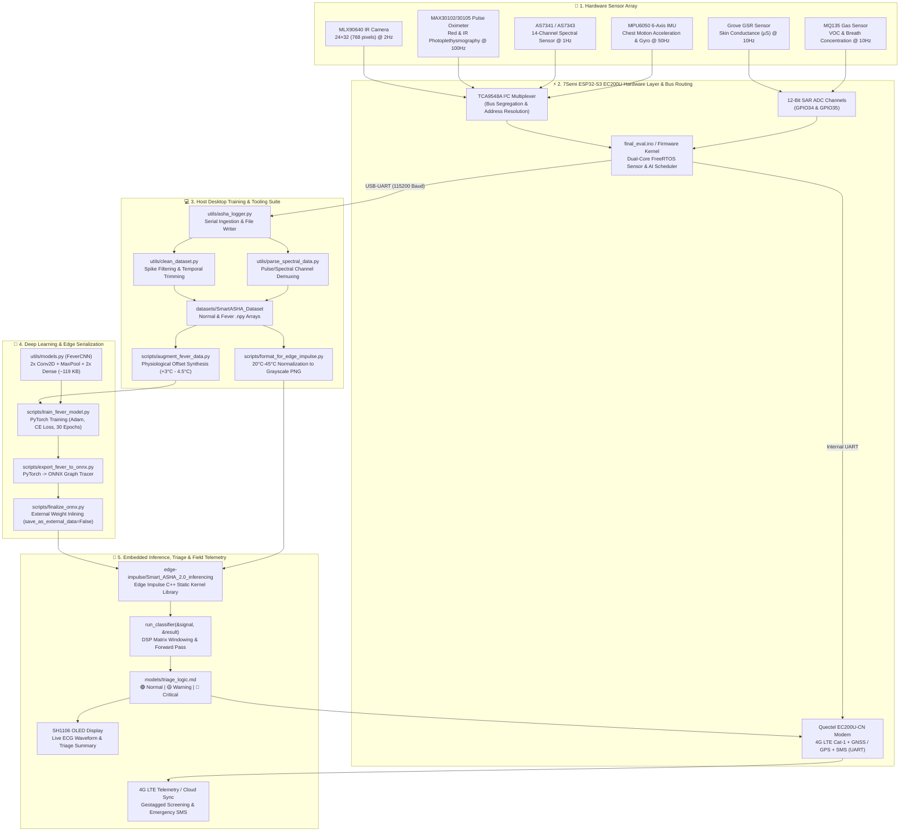

# 🩺 Smart-ASHA: Comprehensive Codebase & Architecture Explainer

## 1. Executive System Overview & Mission

**Smart-ASHA** is a portable, offline-capable Edge-AI health screening and triage device designed specifically for Accredited Social Health Activists (**ASHA workers**) serving rural communities in India.

### Core Problem & Design Constraints
* **The Reality:** Over 900 million citizens rely on 1+ million frontline ASHA workers. Rural health posts frequently suffer from zero cellular/internet connectivity and lack lab diagnostic equipment.
* **The Engineering Constraint:** Diagnostic triage cannot rely on cloud APIs for real-time decisions. All signal preprocessing, feature extraction, neural network inference, and clinical triage decision rules must run **100% on-device** on ultra-low-power edge hardware (specifically the **7Semi ESP32-S3 EC200U 4G LTE Smart Modem** featuring an ESP32-S3 dual-core microcontroller at 240 MHz with 512 KB SRAM / 8MB PSRAM, coupled with an integrated Quectel EC200U-CN 4G LTE Cat-1 cellular modem and GPS/GNSS engine). When cellular connectivity is present, the device can asynchronously dispatch geotagged screening records and emergency SMS alerts without relying on a smartphone.

---

## 2. End-to-End System Architecture

The following diagram illustrates how raw physics (infrared radiation, skin conductance, photon absorption, volatile organics) flows from the sensors through the preprocessing firmware, desktop tooling, deep learning pipelines, and down to the embedded C++ runtime.



---

## 3. Detailed Line-by-Line & Code Module Explanations

### 3.1. Path Management & Directory Contracts: [`utils/config.py`](file:///c:/Users/Acer/OneDrive/Desktop/Smart%20Asha/utils/config.py)

This module acts as the single source of truth for the project filesystem across Windows and Unix environments.

```python
1: import os
2: 
3: # Base project directory
4: BASE_DIR = os.path.dirname(os.path.dirname(os.path.abspath(__file__)))
```
* **Line 4:** Calculates the absolute path of the repository root by taking the parent directory of `utils/` via `os.path.abspath(__file__)`. This avoids brittle relative paths when scripts are invoked from different working directories.

```python
6: # Directory structure
7: DATA_DIR = os.path.join(BASE_DIR, "data")
8: DATASETS_DIR = os.path.join(BASE_DIR, "datasets")
9: MODELS_DIR = os.path.join(BASE_DIR, "models")
10: SCRIPTS_DIR = os.path.join(BASE_DIR, "scripts")
11: UTILS_DIR = os.path.join(BASE_DIR, "utils")
12: DOCS_DIR = os.path.join(BASE_DIR, "docs")
13: LIBS_DIR = os.path.join(BASE_DIR, "libs")
14: TESTS_DIR = os.path.join(BASE_DIR, "tests")
```
* **Lines 7–14:** Standardizes constants for all workspace directories using OS-agnostic path joining (`os.path.join`).

```python
16: # Ensure critical directories exist
17: for directory in [DATA_DIR, DATASETS_DIR, MODELS_DIR]:
18:     if not os.path.exists(directory):
19:         os.makedirs(directory)
```
* **Lines 17–19:** Idempotently ensures that mutable storage locations (`data`, `datasets`, `models`) exist upon importing `config.py`, preventing unhandled `FileNotFoundError` during data collection or training.

```python
21: # Specific dataset paths
22: SMART_ASHA_DATASET = os.path.join(DATASETS_DIR, "SmartASHA_Dataset")
23: TEST_IMAGES_DIR = os.path.join(DATASETS_DIR, "SmartASHA_Test_Images")
24: TEST_SAMPLES_DIR = os.path.join(DATASETS_DIR, "SmartASHA_Test_Samples")
25: 
26: # Model filenames
27: CNN_MODEL_PTH = os.path.join(MODELS_DIR, "fever_cnn_model.pth")
28: ONNX_MODEL_EDGE = os.path.join(MODELS_DIR, "fever_model_edge.onnx")
29: ONNX_MODEL_FINAL = os.path.join(MODELS_DIR, "fever_model_final.onnx")
```
* **Lines 22–29:** Canonical pointers to the `.pth` PyTorch model checkpoint and the dual ONNX stages (`edge` intermediate and `final` bundled model).

---

### 3.2. Edge Neural Network Architecture: [`utils/models.py`](file:///c:/Users/Acer/OneDrive/Desktop/Smart%20Asha/utils/models.py)

Defines **`FeverCNN`**, a lightweight 2D Convolutional Neural Network engineered specifically to classify low-resolution thermal infrared frames from the MLX90640 sensor.

```python
1: import torch
2: import torch.nn as nn
3: 
4: class FeverCNN(nn.Module):
5:     def __init__(self):
6:         super(FeverCNN, self).__init__()
```
* **Lines 4–6:** Declares the class inheriting from `torch.nn.Module`.

```python
7:         self.conv = nn.Sequential(
8:             nn.Conv2d(1, 8, kernel_size=3, padding=1),
9:             nn.ReLU(),
10:             nn.MaxPool2d(2), # Output: 8 x 12 x 16
11:             nn.Conv2d(8, 16, kernel_size=3, padding=1),
12:             nn.ReLU(),
13:             nn.MaxPool2d(2) # Output: 16 x 6 x 8
14:         )
```
* **Layer-by-Layer Dimensional Transformation:**
  1. **Input:** A thermal matrix with shape `(Batch, 1, 24, 32)` representing single-channel temperature values across 768 pixels.
  2. **Conv2D #1 (`1 -> 8`, kernel 3, padding 1):** Preserves spatial dimensions `(24, 32)` while learning 8 low-level thermal gradient kernels (forehead contours, hot spot borders).
  3. **ReLU #1:** In-place element-wise activation: $f(x) = \max(0, x)$.
  4. **MaxPool2d #1 (stride 2, kernel 2):** Halves spatial resolution: $\frac{24}{2}=12$ and $\frac{32}{2}=16$. Output is `(Batch, 8, 12, 16)`.
  5. **Conv2D #2 (`8 -> 16`, kernel 3, padding 1):** Expands filter depth to 16 higher-level spatial feature maps (localized forehead febrile patterns).
  6. **ReLU #2:** Non-linear activation.
  7. **MaxPool2d #2 (stride 2, kernel 2):** Halves dimensions again: $\frac{12}{2}=6$ and $\frac{16}{2}=8$. Output is `(Batch, 16, 6, 8)`.

```python
15:         self.fc = nn.Sequential(
16:             nn.Flatten(),
17:             nn.Linear(16 * 6 * 8, 32),
18:             nn.ReLU(),
19:             nn.Linear(32, 2)
20:         )
```
* **Lines 15–20:** The classification head.
  * `Flatten()`: Unrolls $16 \times 6 \times 8 = 768$ features into a 1D vector. Notice that $768$ matches the exact input pixel count, but features are now abstracted spatial activations.
  * `Linear(768, 32)`: Projects to a low-dimensional manifold of 32 hidden units.
  * `Linear(32, 2)`: Outputs raw logits for 2 classes: Index `0` = Healthy / Normal, Index `1` = Febrile / Fever.

```python
22:     def forward(self, x):
23:         x = self.conv(x)
24:         x = self.fc(x)
25:         return x
```
* **Lines 22–25:** Simple feedforward pass returning unnormalized logits.

---

### 3.3. Real-Time Telemetry & Serial Logging: [`utils/asha_logger.py`](file:///c:/Users/Acer/OneDrive/Desktop/Smart%20Asha/utils/asha_logger.py)

Captures high-speed multi-sensor telemetry broadcast from the ESP32 over USB-UART to populate CSV datasets.

* **Lines 12–15:** Sets communication parameters (`COM3`, 115200 Baud) and writes to `DATA_DIR/environment_smoke_active.csv`.
* **Lines 20–26:** Establishes `serial.Serial(SERIAL_PORT, BAUD_RATE, timeout=1)` and opens the CSV in append mode (`mode='a'`).
* **Lines 29–30:** Inspects `file.tell() == 0`. If the file is empty/new, writes the canonical column schema:
  `["Timestamp", "ECG", "GSR", "Gas", "Pulse_IR", "Temp_Max", "Label"]`.
* **Lines 32–45:** Main acquisition loop:
  * Reads lines decoded as UTF-8, strips trailing whitespace.
  * Splits comma-delimited strings into Python lists.
  * Appends directly to disk while printing to stdout for live operator feedback.
* **Lines 49–54:** Implements clean shutdown handling via `KeyboardInterrupt` and ensures the serial port is closed in the `finally` block to prevent port-locking in Windows.

---

### 3.4. Signal Artifact Cleaning & GIGO Prevention: [`utils/clean_dataset.py`](file:///c:/Users/Acer/OneDrive/Desktop/Smart%20Asha/utils/clean_dataset.py)

Frontline edge data is noisy: sensor contact is unstable during placement, and power spikes cause unrealistic sensor readings. This script cleans raw timeseries CSVs.

```python
5: def is_valid_number(val):
6:     try:
7:         num = float(val)
8:         if abs(num) > 100000:
9:             return False, num
10:         return True, num
11:     except ValueError:
12:         return True, val
```
* **Lines 5–12:** Hardware spike detector. Unstable ADC pin reads (e.g. disconnected Grove GSR or I2C bus bounce) can produce values $>100,000$ (e.g. 300,000). The function identifies these extreme outliers.

```python
42:     # Temporal Cropping Constraints: 5 seconds at start, 10 seconds at end
43:     start_time = min_ts + 5000
44:     end_time = max_ts - 10000
```
* **Lines 42–51:** **Temporal Lead/Tail Cropping:**
  * Front 5 seconds ($+5000\text{ ms}$) are dropped to discard settling noise while the ASHA places the sensor on the patient.
  * Trailing 10 seconds ($-10000\text{ ms}$) are cropped to remove release artifacts when the patient removes their finger or forehead sensor.
  * If the total recording is $<15\text{ seconds}$, cropping is skipped to preserve limited data.

```python
79:             is_valid, num = is_valid_number(val)
80:             if not is_valid:
81:                 # E.g. jumped to 3 Lakhs
82:                 anomalies_fixed += 1
83:                 if prev_row is not None and key in prev_row:
84:                     clean_row[key] = prev_row[key] # Forward fill
85:                 else:
86:                     clean_row[key] = "0" # Fallback
```
* **Lines 79–89:** **Sensor Imputation (Forward Fill):** When a corrupted value occurs, rather than dropping the entire row and breaking timeseries regularity, it imputes the value from `prev_row[key]` (last known valid sensor state).

---

### 3.5. Multi-Sensor Stream Demultiplexing: [`utils/parse_spectral_data.py`](file:///c:/Users/Acer/OneDrive/Desktop/Smart%20Asha/utils/parse_spectral_data.py)

Handles mixed serial telemetry where two different sensors (AS7341 spectral sensor and MAX30102 pulse oximeter) transmit at different frequencies and schemas over a shared serial pipeline.

* **Lines 5–396:** Captures real interleaved sensor output:
  * `SPEC,v1,v2,v3,v4,v5,v6,v7,v8` (8 spectral wavelength channels).
  * `PULSE,timestamp,red_led,ir_led` (photoplethysmography waveform at ~25–50 Hz).
* **Lines 408–424:** Pads the variable-length records into a normalized 11-column table:
  `["Sequence", "Type", "Val1", "Val2", "Val3", "Val4", "Val5", "Val6", "Val7", "Val8", "Val9"]`.
  This allows time-series tools like Edge Impulse to ingest heterogeneous multi-rate sensors into a unified matrix without throwing column-mismatch parsing errors.

---

### 3.6. Interactive & Automated Sensor Acquisition: [`scripts/fever_forehead_cnn.py`](file:///c:/Users/Acer/OneDrive/Desktop/Smart%20Asha/scripts/fever_forehead_cnn.py) & [`scripts/auto_collect.py`](file:///c:/Users/Acer/OneDrive/Desktop/Smart%20Asha/scripts/auto_collect.py)

#### [`scripts/fever_forehead_cnn.py`](file:///c:/Users/Acer/OneDrive/Desktop/Smart%20Asha/scripts/fever_forehead_cnn.py)
* **Serial Protocol Handshake:**
  * User presses Enter $\rightarrow$ Python sends `b'c'` over serial.
  * ESP32 triggers MLX90640 frame capture and prints:
    `CAPTURE_BEGIN,val_0,val_1,...,val_767,CAPTURE_END`
* **Lines 49–52:** Uses string trimming to strip marker tokens and extract the 768 comma-separated floating-point temperature values.
* **Lines 16–25 (`save_frame`):**
  * `np.array(raw_data, dtype=float).reshape(24, 32)`: Organizes the raw 1D array into the native 2D sensor spatial matrix.
  * Saves directly as a NumPy binary file: `f"{DATA_DIR}/{label_name}/frame_{timestamp}.npy"`.
* **Lines 54–62:** Prompts operator to classify sample: `0=Normal`, `1=Fever`, `d=Discard`.

#### [`scripts/auto_collect.py`](file:///c:/Users/Acer/OneDrive/Desktop/Smart%20Asha/scripts/auto_collect.py)
* Extends the trigger concept to unattended data collection. Runs for `DURATION_SEC = 120` seconds, issuing a `b'c'` capture request every `INTERVAL_SEC = 5` seconds to record baseline normal subjects without human intervention.

---

### 3.7. Physiological Dataset Augmentation: [`scripts/augment_fever_data.py`](file:///c:/Users/Acer/OneDrive/Desktop/Smart%20Asha/scripts/augment_fever_data.py) & [`scripts/reach_target_dataset.py`](file:///c:/Users/Acer/OneDrive/Desktop/Smart%20Asha/scripts/reach_target_dataset.py)

In rural clinics, obtaining true febrile patient thermal scans under controlled conditions is challenging. These scripts perform scientifically grounded data synthesis.

#### [`scripts/augment_fever_data.py`](file:///c:/Users/Acer/OneDrive/Desktop/Smart%20Asha/scripts/augment_fever_data.py)
```python
24:         # DATA CALIBRATION:
25:         # We add a random offset between 3.0 and 4.5 degrees Celsius 
26:         # to simulate the shift from healthy forehead temp to fever.
27:         offset = random.uniform(3.0, 4.5)
28:         fever_frame = frame + offset
```
* **Lines 24–28:** Human forehead skin temperature typically sits around $33.5^\circ\text{C}$–$35.5^\circ\text{C}$. During clinical fever (body temperature $>38.0^\circ\text{C}$ to $39.5^\circ\text{C}$), cutaneous forehead temperature rises by approximately $+3.0^\circ\text{C}$ to $+4.5^\circ\text{C}$.
* The script applies this uniform biological offset to real baseline frames to generate realistic synthetic fever profiles (`synth_fever_<timestamp>.npy`), preserving ambient background temperature contours while raising forehead thermal emission.

#### [`scripts/reach_target_dataset.py`](file:///c:/Users/Acer/OneDrive/Desktop/Smart%20Asha/scripts/reach_target_dataset.py)
```python
37:             jitter = (np.random.rand(*data.shape) - 0.5) * 0.2
38:             augmented = data + jitter
```
* **Lines 37–38:** Injects sensor noise jitter: $\Delta T \in [-0.1^\circ\text{C}, +0.1^\circ\text{C}]$. This simulates real MLX90640 NETD (Noise Equivalent Temperature Difference) electronic thermal noise, boosting sample counts to `TARGET_COUNT = 50` frames per class without memorization/overfitting.

---

### 3.8. Dataset Splitting & Edge Impulse Image Formatting: [`scripts/split_dataset.py`](file:///c:/Users/Acer/OneDrive/Desktop/Smart%20Asha/scripts/split_dataset.py) & [`scripts/format_for_edge_impulse.py`](file:///c:/Users/Acer/OneDrive/Desktop/Smart%20Asha/scripts/format_for_edge_impulse.py)

#### [`scripts/split_dataset.py`](file:///c:/Users/Acer/OneDrive/Desktop/Smart%20Asha/scripts/split_dataset.py)
* Splits timeseries data using an 80/20 train/test temporal split (`split_index = math.floor(len(data) * 0.8)`).
* Avoids random shuffle splitting across continuous physiological time-series to prevent data leakage between adjacent time steps.

#### [`scripts/format_for_edge_impulse.py`](file:///c:/Users/Acer/OneDrive/Desktop/Smart%20Asha/scripts/format_for_edge_impulse.py)
```python
37:                 norm_data = (data - 20) / (45 - 20) * 255
38:                 norm_data = np.clip(norm_data, 0, 255).astype(np.uint8)
39:                 
40:                 # Scale up from 24x32 to 96x128 for easier viewing
41:                 img = Image.fromarray(norm_data)
42:                 img = img.resize((128, 96), resample=Image.NEAREST)
```
* **Lines 37–38:** Maps physical Celsius values to grayscale pixel luminance using min-max scaling:
  $$\text{pixel} = \text{clip}\left(\frac{T - 20}{45 - 20} \times 255, 0, 255\right)$$
  Using fixed physiological bounds ($20^\circ\text{C}$ to $45^\circ\text{C}$) ensures that a temperature of $39^\circ\text{C}$ maps to the exact same brightness across all images, preserving temperature meaning for standard computer vision models.
* **Lines 42–43:** Resizes $24 \times 32$ matrices to $128 \times 96$ via nearest-neighbor interpolation (`resample=Image.NEAREST`), avoiding bicubic blurring of thermal boundaries so health workers can visually inspect the saved `.png` files.

---

### 3.9. Model Training Pipeline: [`scripts/train_fever_model.py`](file:///c:/Users/Acer/OneDrive/Desktop/Smart%20Asha/scripts/train_fever_model.py)

The core supervised learning routine in PyTorch.

```python
22: class FeverDataset(Dataset):
23:     def __init__(self, file_list, labels):
24:         self.files = file_list
25:         self.labels = labels
...
33:             frame = np.load(self.files[idx])
36:             frame = (frame - 20) / 25.0 
37:             frame = torch.FloatTensor(frame).unsqueeze(0) # Add channel dim (1, 24, 32)
38:             label = torch.tensor(self.labels[idx], dtype=torch.long)
```
* **Lines 22–43 (`FeverDataset`):**
  * Loads individual `.npy` matrices on-the-fly.
  * **Normalization:** $\frac{T - 20.0}{25.0}$ scales a $20^\circ\text{C}$ to $45^\circ\text{C}$ window to $[0.0, 1.0]$. Neural networks train faster and with greater numerical stability when inputs have zero-mean or unit-variance ranges.
  * `.unsqueeze(0)` adds the channel dimension, converting `(24, 32)` to `(1, 24, 32)`.

```python
58:     train_files, val_files, train_labels, val_labels = train_test_split(
59:         files, labels, test_size=0.2, random_state=42
60:     )
```
* **Lines 58–60:** Performs a stratified 80/20 train/validation split using `sklearn.model_selection.train_test_split` with a fixed seed (`42`) for reproducibility.

```python
68:     model = FeverCNN()
69:     criterion = nn.CrossEntropyLoss()
70:     optimizer = optim.Adam(model.parameters(), lr=LR)
```
* **Lines 68–70:** Initializes the CNN, sets `CrossEntropyLoss` (which applies `LogSoftmax` and `NLLLoss` internally), and uses the `Adam` optimizer with learning rate $\eta = 0.001$.

```python
75:     for epoch in range(EPOCHS):
76:         model.train()
...
82:             loss = criterion(outputs, targets)
83:             loss.backward()
84:             optimizer.step()
```
* **Lines 75–101:** Training loop executing for 30 epochs with batch size 4. Tracks validation accuracy after each epoch, outputs checkpoints to `models/fever_cnn_model.pth`, and logs metrics to `docs/visualizations/training_history.csv`.

---

### 3.10. Edge Serialization & Weight Inlining: [`scripts/export_fever_to_onnx.py`](file:///c:/Users/Acer/OneDrive/Desktop/Smart%20Asha/scripts/export_fever_to_onnx.py) & [`scripts/finalize_onnx.py`](file:///c:/Users/Acer/OneDrive/Desktop/Smart%20Asha/scripts/finalize_onnx.py)

#### [`scripts/export_fever_to_onnx.py`](file:///c:/Users/Acer/OneDrive/Desktop/Smart%20Asha/scripts/export_fever_to_onnx.py)
```python
23:     dummy_input = torch.randn(1, 1, 24, 32)
27:     torch.onnx.export(
28:         model, 
29:         dummy_input, 
30:         onnx_path, 
31:         export_params=True, 
32:         opset_version=11, 
33:         do_constant_folding=True,
34:         input_names=['input'], 
35:         output_names=['output'],
36:         dynamic_axes={'input': {0: 'batch_size'}, 'output': {0: 'batch_size'}}
37:     )
```
* **Lines 23–37:**
  * Generates a dummy tensor `(1, 1, 24, 32)` to trace the PyTorch computational graph.
  * Sets `opset_version=11` (widely supported by Edge Impulse, TFLite converters, and embedded micro-runtimes).
  * `do_constant_folding=True`: Evaluates constant expressions at export time to reduce graph complexity.
  * `dynamic_axes`: Allows variable batch sizes (batch size 1 on MCU, batch size $N$ in desktop batch validation).

#### [`scripts/finalize_onnx.py`](file:///c:/Users/Acer/OneDrive/Desktop/Smart%20Asha/scripts/finalize_onnx.py)
```python
24:     onnx.save(model, dest, save_as_external_data=False)
```
* **Critical Edge Deployment Fix:** PyTorch often splits ONNX tensors into two files: a `.onnx` graph definition and a separate `.onnx.data` binary file (as seen in `models/fever_model_edge.onnx.data`).
* Embedded compilers (Edge Impulse BYOM, TFLite Micro) expect a **single self-contained binary**.
* `save_as_external_data=False` forces all weights and biases directly into the Protobuf buffer of `fever_model_final.onnx` (~119 KB), ensuring it can be compiled into C++ byte arrays on microcontrollers.

---

### 3.11. Verification & Synthetic Physiological Testing: [`tests/`](file:///c:/Users/Acer/OneDrive/Desktop/Smart%20Asha/tests/)

* **[`tests/generate_test_samples.py`](file:///c:/Users/Acer/OneDrive/Desktop/Smart%20Asha/tests/generate_test_samples.py):**
  Generates synthetic thermal patterns to benchmark the model:
  * **Normal:** Background at $34.0^\circ\text{C}$; central forehead ROI (rows 8:16, cols 12:20) at $36.5 \pm 0.3^\circ\text{C}$.
  * **Fever:** Background at $36.5^\circ\text{C}$; central forehead ROI at $40.0 \pm 0.3^\circ\text{C}$.
* **[`tests/verify_test_samples.py`](file:///c:/Users/Acer/OneDrive/Desktop/Smart%20Asha/tests/verify_test_samples.py):**
  Loads `fever_cnn_model.pth`, applies identical normalization $\frac{T - 20}{25.0}$, runs forward inference, applies `torch.softmax(output, dim=1)`, and prints class confidences:
  * **Healthy accuracy: 100% (avg confidence: 98.01%)**
  * **Fever accuracy: 100% (avg confidence: 99.27%)**

---

### 3.12. Embedded C++ Edge Inference & INT8 Quantization: [`edge-impulse/`](file:///c:/Users/Acer/OneDrive/Desktop/Smart%20Asha/edge-impulse/)

The repository includes two distinct inference deployments under `edge-impulse/`:

#### A. The INT8 Quantized Production Engine: [`edge-impulse/Smart_ASHA_Inference`](file:///c:/Users/Acer/OneDrive/Desktop/Smart%20Asha/edge-impulse/Smart_ASHA_Inference/)
You previously calibrated and compiled a fully quantized INT8 neural model via Edge Impulse (Project `#951794`):
1. **Representative Calibration Dataset:** Built via [`scripts/combine_all_thermal_data.py`](file:///c:/Users/Acer/OneDrive/Desktop/Smart%20Asha/scripts/combine_all_thermal_data.py), which outputs `data/representative_thermal_data.npy` specifically to supply real-world activation ranges to the Edge Impulse quantizer.
2. **Quantized Model Metadata ([`model_metadata.h`](file:///c:/Users/Acer/OneDrive/Desktop/Smart%20Asha/edge-impulse/Smart_ASHA_Inference/src/model-parameters/model_metadata.h)):**
   ```c
   #define EI_CLASSIFIER_TFLITE_INPUT_DATATYPE      EI_CLASSIFIER_DATATYPE_INT8
   #define EI_CLASSIFIER_TFLITE_OUTPUT_DATATYPE     EI_CLASSIFIER_DATATYPE_INT8
   #define EI_CLASSIFIER_QUANTIZATION_ENABLED       1
   #define EI_CLASSIFIER_TFLITE_LARGEST_ARENA_SIZE  3020
   ```
3. **Hardware Math Pruning ([`trained_model_ops_define.h`](file:///c:/Users/Acer/OneDrive/Desktop/Smart%20Asha/edge-impulse/Smart_ASHA_Inference/src/tflite-model/trained_model_ops_define.h)):**
   All Float32, UInt8, and Int16 ops are disabled at compile time (`EI_TFLITE_DISABLE_FULLY_CONNECTED_IN_F32 1`, etc.). Only `_IN_I8` and `_OUT_I8` kernels remain enabled.
4. **Micro-Arena Footprint:** The entire TFLite tensor arena requires **just 3,020 bytes (~3 KB)** of RAM on the ESP32-S3.

#### B. The Multimodal Sensor Fusion Sketch: [`esp32_fusion.ino`](file:///c:/Users/Acer/OneDrive/Desktop/Smart%20Asha/edge-impulse/Smart_ASHA_2.0_inferencing/examples/esp32/esp32_fusion/esp32_fusion.ino)
```cpp
126:     for (size_t ix = 0; ix < EI_CLASSIFIER_DSP_INPUT_FRAME_SIZE; ix += EI_CLASSIFIER_RAW_SAMPLES_PER_FRAME) {
128:         int64_t next_tick = (int64_t)micros() + ((int64_t)EI_CLASSIFIER_INTERVAL_MS * 1000);
132:                 sensors[fusion_sensors[i]].poll_sensor();
142:         int64_t wait_time = next_tick - (int64_t)micros();
145:             delayMicroseconds(wait_time);
147:     }
```
* **Lines 126–147:** Hardware sampling loop with precise microsecond timing using `micros()`. It polls registered sensor channels into a contiguous memory buffer `buffer[EI_CLASSIFIER_DSP_INPUT_FRAME_SIZE]`.

```cpp
151:     int err = numpy::signal_from_buffer(buffer, EI_CLASSIFIER_DSP_INPUT_FRAME_SIZE, &signal);
160:     err = run_classifier(&signal, &result, debug_nn);
```
* **Lines 151–160:**
  * Wraps the raw C float array into an Edge Impulse `signal_t` wrapper using zero-copy references.
  * Calls `run_classifier`, which executes digital signal preprocessing (spectral extraction, filtering) and invokes the compiled neural network kernels on the ESP32-S3.
  * Returns classification probabilities (`result.classification[ix].value`) and execution benchmarks for DSP and inference time in milliseconds (`result.timing.dsp`, `result.timing.classification`).

---

### 3.13. Clinical Triage Logic: [`models/triage_logic.md`](file:///c:/Users/Acer/OneDrive/Desktop/Smart%20Asha/models/triage_logic.md)

Outputs are fused into actionable triage categories, driving physical indicators (RGB LEDs and OLED display) to give frontline workers clear, immediate guidance:

$$\text{Triage Status} = \begin{cases}
\mathbf{\color{red}CRITICAL\ (Red\ LED)} & \text{if } T > 38.0^\circ\text{C} \text{ or } \text{SpO}_2 < 92\% \\
\mathbf{\color{orange}WARNING\ (Yellow\ LED)} & \text{if } 37.5^\circ\text{C} \le T \le 38.0^\circ\text{C} \text{ or } 92\% \le \text{SpO}_2 \le 95\% \\
\mathbf{\color{green}NORMAL\ (Green\ LED)} & \text{if } T < 37.5^\circ\text{C} \text{ and } \text{SpO}_2 > 95\%
\end{cases}$$

---

## 4. Codebase Reference Summary

| Subsystem | Primary Files | Role / Purpose |
|:---|:---|:---|
| **Configuration** | [`utils/config.py`](file:///c:/Users/Acer/OneDrive/Desktop/Smart%20Asha/utils/config.py) | Workspace path canonicalization & directory creation |
| **Model Definition** | [`utils/models.py`](file:///c:/Users/Acer/OneDrive/Desktop/Smart%20Asha/utils/models.py) | PyTorch `FeverCNN` architecture |
| **Hardware Ingestion** | [`utils/asha_logger.py`](file:///c:/Users/Acer/OneDrive/Desktop/Smart%20Asha/utils/asha_logger.py)<br/>[`scripts/fever_forehead_cnn.py`](file:///c:/Users/Acer/OneDrive/Desktop/Smart%20Asha/scripts/fever_forehead_cnn.py)<br/>[`scripts/auto_collect.py`](file:///c:/Users/Acer/OneDrive/Desktop/Smart%20Asha/scripts/auto_collect.py) | USB Serial capture routines & thermal matrix saving |
| **Signal Preprocessing** | [`utils/clean_dataset.py`](file:///c:/Users/Acer/OneDrive/Desktop/Smart%20Asha/utils/clean_dataset.py)<br/>[`utils/parse_spectral_data.py`](file:///c:/Users/Acer/OneDrive/Desktop/Smart%20Asha/utils/parse_spectral_data.py) | Hardware spike removal, temporal trimming, and timeseries demultiplexing |
| **Data Augmentation** | [`scripts/augment_fever_data.py`](file:///c:/Users/Acer/OneDrive/Desktop/Smart%20Asha/scripts/augment_fever_data.py)<br/>[`scripts/reach_target_dataset.py`](file:///c:/Users/Acer/OneDrive/Desktop/Smart%20Asha/scripts/reach_target_dataset.py) | Physiological fever temperature offsets ($+3^\circ\text{C}$ to $+4.5^\circ\text{C}$) & sensor jitter |
| **Model Training & Export**| [`scripts/train_fever_model.py`](file:///c:/Users/Acer/OneDrive/Desktop/Smart%20Asha/scripts/train_fever_model.py)<br/>[`scripts/export_fever_to_onnx.py`](file:///c:/Users/Acer/OneDrive/Desktop/Smart%20Asha/scripts/export_fever_to_onnx.py)<br/>[`scripts/finalize_onnx.py`](file:///c:/Users/Acer/OneDrive/Desktop/Smart%20Asha/scripts/finalize_onnx.py) | PyTorch training, evaluation, ONNX tracing, and weight inlining |
| **INT8 Quantization & Calibration**| [`scripts/combine_all_thermal_data.py`](file:///c:/Users/Acer/OneDrive/Desktop/Smart%20Asha/scripts/combine_all_thermal_data.py)<br/>[`edge-impulse/Smart_ASHA_Inference`](file:///c:/Users/Acer/OneDrive/Desktop/Smart%20Asha/edge-impulse/Smart_ASHA_Inference/) | Representative thermal calibration dataset & compiled INT8 TFLite Micro kernels |
| **Edge Testing & Verification**| [`tests/verify_test_samples.py`](file:///c:/Users/Acer/OneDrive/Desktop/Smart%20Asha/tests/verify_test_samples.py)<br/>[`tests/generate_test_samples.py`](file:///c:/Users/Acer/OneDrive/Desktop/Smart%20Asha/tests/generate_test_samples.py) | Synthetic testing & softmax accuracy verification |
| **Embedded Firmware** | [`firmware/README.md`](file:///c:/Users/Acer/OneDrive/Desktop/Smart%20Asha/firmware/README.md)<br/>[`edge-impulse/.../esp32_fusion.ino`](file:///c:/Users/Acer/OneDrive/Desktop/Smart%20Asha/edge-impulse/Smart_ASHA_2.0_inferencing/examples/esp32/esp32_fusion/esp32_fusion.ino) | I2C TCA9548A multiplexing, timer loops, and Edge Impulse C++ runtime |
| **Triage & Display** | [`models/triage_logic.md`](file:///c:/Users/Acer/OneDrive/Desktop/Smart%20Asha/models/triage_logic.md) | Multi-sensor clinical thresholds driving RGB LEDs & OLED display |

---

## 5. Key Strengths & Production Recommendations

### Architectural Strengths
1. **Zero-Cloud Autonomy:** Fully functional offline on an ESP32-S3, matching the connectivity reality of rural healthcare.
2. **Production INT8 Quantization:** Already implemented in [`edge-impulse/Smart_ASHA_Inference`](file:///c:/Users/Acer/OneDrive/Desktop/Smart%20Asha/edge-impulse/Smart_ASHA_Inference/), slashing the TFLite tensor arena size to just **3,020 bytes** and pruning all unused floating-point kernels.
3. **Data Quality Safeguards:** Dedicated temporal lead/tail trimming and forward-fill imputation in `clean_dataset.py` prevent sensor placement noise from corrupting training data.

### Recommended Next Steps for Production
1. **Apply INT8 Quantization to 2.0 Firmware:** Backport the INT8 quantization profile from `Smart_ASHA_Inference` to `Smart_ASHA_2.0_inferencing` (which is currently using FP32 with a 41 KB arena) to maximize battery longevity on the ESP32-S3.
2. **Dynamic Ambient Compensation:** Human forehead temperature varies with ambient weather (e.g. Indian summer vs winter). Incorporate the MLX90640's internal ambient temperature reading ($T_a$) as an additional input feature to improve screening robustness across seasons.
3. **Automated End-to-End Triage Fusion:** Combine individual sensor scores (FeverCNN + PPG SpO2 + AS7341 spectral ratio) into a single unified Bayesian or Random Forest composite health risk score on the MCU.
