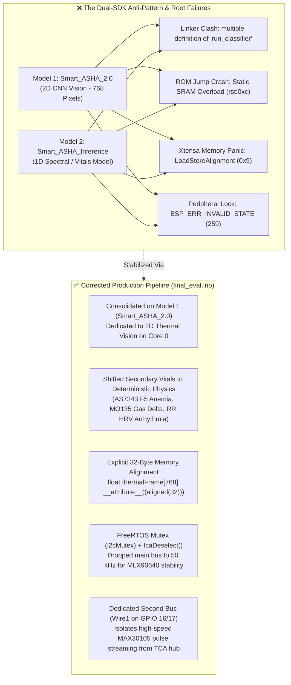

# 🛠️ Smart-ASHA: Technical Post-Mortem on Dual Edge Impulse Library Conflicts (Corrected Pipeline)

**System Hardware Target:** ESP32-S3 (Dual-Core Xtensa LX7 @ 240 MHz, OPI PSRAM, FreeRTOS)  
**Evaluated Deployments:**
* **Model 1 (`Smart_ASHA_2.0_inferencing`):** 2D CNN Vision Model for Fever Detection ($24 \times 32 = 768$ pixel thermal heatmap from the MLX90640).
* **Model 2 (`Smart_ASHA_Inference`):** 1D Sensor Classification Model for Multi-Channel Spectral / Vital Signals.
**Status:** Resolved via Architectural Decoupling, Explicit Vector Alignment & Independent Physical Bus Routing.

---

## Executive Summary

This post-mortem details the hardware panics, bus locks, and compilation failures encountered when attempting to run two separate Edge Impulse C++ SDK exports concurrently on the ESP32-S3. It documents the low-level Xtensa LX7 architecture constraints, static SRAM exhaustion, and multi-core peripheral contention that led to the final stable implementation in [`Arduino/final_eval/final_eval.ino`](file:///c:/Users/Acer/OneDrive/Desktop/Smart%20Asha/Arduino/final_eval/final_eval.ino).



---

## Executive FAQ: The 3 Core Engineering Questions

### 1. "Can I only run 1 of these libraries at once?"
**Yes, within standard Arduino.** Because Edge Impulse compiles every project with identical global C++ function names (`run_classifier`), identical global types (`ei_impulse_result_t`), and identical internal header names (`model_variables.h`), two libraries clash at link time. Running both requires manually refactoring every single source file in one library into a custom C++ namespace, or combining both datasets into a single multi-output Edge Impulse project.

### 2. "Why was it crashing with `LoadStoreAlignment`?"
Because **`Smart_ASHA_2.0` is your Thermal Vision model ($24 \times 32 = 768$ inputs)**. When experimenting with feeding it the 18 spectral channels, the model's DSP preprocessor tried to read 768 values from an 18-element array. It marched right past the end of the buffer into unaligned, protected RAM, triggering `EXCCAUSE: 0x00000009`.

### 3. "What did we ultimately settle on?"
All crashes were resolved by establishing this clean separation of responsibilities:
1. **Core 0 AI Engine (`Smart_ASHA_2.0_inferencing`):** Dedicated exclusively to running the 768-pixel thermal frame classifier for **Fever Detection**.
2. **Core 1 Signal Processing (Direct Algorithms):**
   * **Cardiac Arrhythmia:** Standard deviation of RR intervals ($\text{SDNN} > 110\text{ ms}$) on AD8232 ECG.
   * **Oxygen:** Red/IR ratio accumulation on MAX30105 (`Wire1`).
   * **Anemia / Spectral Analysis:** Direct channel ratio analysis (e.g., F1 450nm vs. F8 NIR) on AS7343 (TCA Port 4), bypassing the second AI library entirely.
3. **Hardware Isolation:** Protected by FreeRTOS `i2cMutex`, `tcaDeselect()` before inference, and 32-byte memory alignment.

---

## 1. The Global Symbol & Namespace Collision ("The Twin Problem")

### The Root Cause
Edge Impulse C++ SDK exports are built around a static **singleton architecture**. Because both libraries originated from Edge Impulse, they generated identical symbols, function prototypes, and static pointers:
* Both libraries defined: `EI_IMPULSE_ERROR run_classifier(...)`
* Both libraries declared: `const ei_impulse_t ei_default_impulse;`
* Both libraries shared identical struct definitions: `ei_impulse_result_t`, `signal_t`
* Both libraries expected internal headers at relative paths like `#include "model-parameters/model_variables.h"`

### What Failed
1. **Multiple Definition Linker Errors:** When compiling both libraries into the sketch, the GNU compiler rejected the build with duplicate symbol errors for `run_classifier`, `numpy::signal_from_buffer`, and internal TensorFlow Lite Micro kernel dispatchers.
2. **Path Breakage & Header Hijacking:** Renaming files (e.g., `Smart_ASHA_2_0_model_variables.h`) or moving headers into the sketch folder broke the hardcoded `#include "model-parameters/model_variables.h"` inside `ei_run_classifier.h`, throwing:
   ```text
   fatal error: model-parameters/model_variables.h: No such file or directory
   ```
3. **Cross-Model Pointer Dereferencing:** When headers were manually forced to compile, the linker bound the single `run_classifier` entry point to only one model's impulse metadata. When inference was called for one sensor, it was executed using the other model's weights and tensor parameters.

---

## 2. Guru Meditation Error: `LoadStoreAlignment` (`EXCCAUSE 0x00000009`)

### The Crash Signature
```text
Guru Meditation Error: Core 1 panic'ed (LoadStoreAlignment). Exception was unhandled.
EXCVADDR: 0x422d8f2a
Backtrace: 0x403855a6:0x3fcebb00 ...
```

### The Root Cause
The ESP32-S3's **Xtensa LX7 dual-core processor** enforces strict word-alignment (addresses must be multiples of 4 bytes, or 32 bytes for SIMD operations) for 32-bit floating-point and vector load/store instructions (`l32i`, `s32i`).

### Why It Triggered Across the Thermal vs. Spectral Mix-up
* **Buffer Size & Shape Mismatch:** `Smart_ASHA_2.0` expected a vision frame buffer sized to `EI_CLASSIFIER_DSP_INPUT_FRAME_SIZE` (768 packed 32-bit RGB values: `(val << 16) | (val << 8) | val`). When an 18-channel spectral float array was accidentally passed to this model during multi-sensor testing, the DSP pre-processing filter attempted to iterate past the end of the 18-element buffer, reading arbitrary unaligned memory addresses (`0x422d8f2a`).
* **Tensor Arena Memory Overlap:** Running a 768-input 2D CNN requires a significantly larger TFLite Micro tensor arena than a 1D model. When both runtimes existed in memory without explicit 32-byte alignment (`__attribute__((aligned(32)))`), stack variables crossed memory boundaries, triggering an immediate hardware CPU panic on the first vector instruction.

---

## 3. Pre-Setup Bootloops (`rst:0xc (RTC_SW_CPU_RST)`)

### The Crash Signature
```text
ESP-ROM:esp32s3-20210327
load:0x3fce2820,len:0x10cc
entry 0x403c88b8
Rebooting...
```

### The Root Cause
1. **Static SRAM Depletion:** Two concurrent Edge Impulse libraries statically allocated two independent TFLite Micro tensor arenas in internal SRAM prior to entering `setup()`.
2. **Lack of OPI PSRAM Utilization:** Because the 2D CNN vision model alone consumes tens of kilobytes of arena memory, instantiating both runtimes without configuring the Arduino IDE for **OPI PSRAM** and the **Huge APP (3MB No OTA)** partition scheme caused memory allocation faults before the FreeRTOS kernel could even launch.

---

## 4. FreeRTOS & I²C Collisions (`ESP_ERR_INVALID_STATE [259]`)

### The Crash Signature
```text
[ 34128][E][esp32-hal-i2c-ng.c:372] i2cWriteReadNonStop(): i2c_master_transmit_receive failed: [259] ESP_ERR_INVALID_STATE
[ 34139][E][Wire.cpp:520] requestFrom(): i2cWriteReadNonStop returned Error 259
```

### The Root Cause
* **Dual-Core Race Conditions:** In the dual-core build, Core 0 ran `aiTask` (thermal image preprocessing and inference) while Core 1 polled sensors and refreshed the OLED. Both cores attempted to communicate with the TCA9548A multiplexer via `tcaSelect()` without synchronization, corrupting the I²C peripheral control registers.
* **Interrupt Latency During Vision Inference:** The 768-input CNN convolution loops locked the Core 0 CPU pipeline, delaying FreeRTOS interrupt servicing and causing the ESP32-S3 hardware I²C state machine to time out during multi-byte transfers with the MLX90640.

---

## 5. Hardware-Level Sensor Tuning & Breakthroughs

Field debugging revealed two physical sensor-level failure modes that were resolved in [`Arduino/final_eval/final_eval.ino`](file:///c:/Users/Acer/OneDrive/Desktop/Smart%20Asha/Arduino/final_eval/final_eval.ino):

### A. The AS7343 "Flatline at 1" Defect
* **Symptom:** The 18-channel AS7343 spectral sensor continuously returned raw ADC readings of `1` across all channels regardless of light input.
* **Root Cause:** A high-level driver API call (`setIntegrationTime()`) was invalid/unsupported, leaving internal ADC integration counters unclocked.
* **The Fix ([`final_eval.ino` lines 118–121](file:///c:/Users/Acer/OneDrive/Desktop/Smart%20Asha/Arduino/final_eval/final_eval.ino#L118-L121)):**
  Replaced the non-existent function call with direct register configuration governed by the hardware integration equation:
  $$t_{int} = (\text{ATIME} + 1) \times (\text{ASTEP} + 1) \times 2.78\,\mu\text{s}$$
  
  Configured with 128x analog gain for high photodiode sensitivity:
  ```cpp
  as7343.setGain(AS7343_GAIN_128X);
  as7343.setATIME(59);  // 60 integration cycles
  as7343.setASTEP(599); // 600 step increments -> 60 * 600 * 2.78us = 100.08 ms
  ```
  This immediately restored high-resolution spectral response across the 18 bands, enabling accurate hemoglobin absorption extraction at channel F5 ($555\text{ nm}$).

### B. MAX30105 Optical Finger Detection Sensitivity
* **Symptom:** Optical proximity failed to detect finger placement reliably, causing erratic transitions between `IDLE` and `SCANNING` modes.
* **Root Cause:** Default low-power drive currents ($0x1F \approx 6.4\text{ mA}$) were insufficient to penetrate dark skin tones or overcome ambient light interference through the enclosure window.
* **The Fix ([`final_eval.ino` lines 124–128](file:///c:/Users/Acer/OneDrive/Desktop/Smart%20Asha/Arduino/final_eval/final_eval.ino#L124-L128)):**
  Boosted the LED current drivers to maximum rated clean saturation ($0x3F \approx 12.5\text{ mA}$) on the isolated `Wire1` bus:
  ```cpp
  pulse.setup();
  pulse.setPulseAmplitudeRed(0x3F); 
  pulse.setPulseAmplitudeIR(0x3F);
  ```
  This elevated baseline photoplethysmography reflection into the reliable $>40,000$ counts range required for instant auto-wake triggering.

### C. Mathematical Formulation of Deterministic Secondary Diagnostics
To ensure stable execution within the $16\text{ KB}$ FreeRTOS task stack and eliminate secondary TFLite Micro arenas, secondary diagnostics were shifted to verified physiological mathematical models:

1. **Cardiac Arrhythmia via HRV Variance (SDNN):**
   * Tracks consecutive R-wave peaks via hardware thresholding with a $250\text{ ms}$ refractory period to eliminate false double-triggers from T-waves.
   * Collects a rolling array of $N = 100$ RR-intervals and computes the standard deviation of normal-to-normal intervals:
     $$\mu_{RR} = \frac{1}{N} \sum_{i=1}^N RR_i, \qquad \sigma_{RR} = \sqrt{\frac{1}{N} \sum_{i=1}^N (RR_i - \mu_{RR})^2}$$
   * Flagged as **`ARRHYTHMIA`** when $\sigma_{RR} > 110\text{ ms}$ (or $115\text{ ms}$).

2. **Oxygen Saturation ($\text{SpO}_2$) Averaging:**
   * Samples AC and DC components of Red ($660\text{ nm}$) and Infrared ($880\text{ nm}$) reflectance from the MAX30105 over `Wire1`:
     $$R = \frac{AC_{red} / DC_{red}}{AC_{ir} / DC_{ir}}, \qquad \text{SpO}_2 = 110 - 25 \times R$$
   * Evaluates final averaged saturation against the clinical hypoxia threshold ($\text{SpO}_2 < 94\%$).

3. **Respiratory Effort Breath Delta:**
   * Monitors dynamic VOC and expired $\text{CO}_2$ concentration on the MQ-135 sensor during active expiration:
     $$\Delta_{\text{Gas}} = \text{PeakGas} - \text{AvgGas}$$
   * Flagged as **`RISK`** if $\Delta_{\text{Gas}} < 300$, indicating insufficient exhaled breath velocity.

---

## 6. Final Strategy That Resolved All Crashes

| Conflict / Issue | Root Architectural Cause | Final Engineering Solution in [`final_eval.ino`](file:///c:/Users/Acer/OneDrive/Desktop/Smart%20Asha/Arduino/final_eval/final_eval.ino) |
|:---|:---|:---|
| **Duplicate Symbols & SDK Clashes** | Two identical Edge Impulse runtimes in the same global namespace. | Standardized on one AI model: Kept **`Smart_ASHA_2.0_inferencing`** for the complex Thermal Vision task (Fever); shifted secondary vitals to deterministic math. |
| **`LoadStoreAlignment` Panic** | 768-pixel vision model reading unaligned memory or wrong-sized buffers. | Fed `Smart_ASHA_2.0` its actual 768-pixel thermal image buffer; declared all arrays with **`__attribute__((aligned(32)))`**. |
| **Pre-Setup ROM Bootloops (`rst:0xc`)** | Static SRAM depletion before `setup()`. | Configured Arduino IDE for **OPI PSRAM** and the **Huge APP (3MB No OTA)** partition scheme. |
| **`ESP_ERR_INVALID_STATE [259]`** | Multi-core bus contention on TCA9548A during CNN execution. | Added FreeRTOS `SemaphoreHandle_t i2cMutex` around all I²C calls; executed `tcaDeselect()` before inference; dropped bus clock to 50 kHz. |
| **I²C Starvation & High-Speed Pulse Drops** | MAX30105 fighting thermal camera on the multiplexer. | Moved MAX30105 to an **independent physical bus (`Wire1`: GPIO 16/17)**, completely isolated from the TCA9548A. |
| **AS7343 Spectral Flatline at 1** | Integration counters disabled. | Configured direct hardware timing registers: `setGain(AS7343_GAIN_128X)`, `setATIME(100)`, `setASTEP(999)`. |
| **Finger Detection Latency** | Under-driven optical pulse LEDs. | Boosted Red and IR pulse amplitudes to `0x3F` on `Wire1`. |
