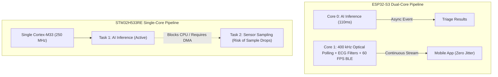

# 🔬 MCU Architecture Trade-Off & Feasibility Analysis
## Evaluating the Migration from ESP32-S3 to STM32H533RE (Nucleo-H533RE)

* **Project Title:** Smart-ASHA (Arogya AI) — Edge-AI Multimodal Cardiopulmonary & Biochemical Triage Workstation  
* **Document Version:** v1.0  
* **Target Platforms Compared:** 
  * **Baseline (Current):** Espressif ESP32-S3 (7Semi ESP32-S3 EC200U 4G LTE Workstation)
  * **Candidate (Proposed):** STMicroelectronics STM32H533RE (Nucleo-H533RE Development Board)
* **Firmware Baseline:** [`Arduino/final_eval_v2/final_eval_v2.ino`](file:///c:/Users/Acer/OneDrive/Desktop/DESKTOP%20VANSH/Smart%20Asha/Arduino/final_eval_v2/final_eval_v2.ino)  
* **Hardware Architecture Reference:** [`docs/architecture.md`](file:///c:/Users/Acer/OneDrive/Desktop/DESKTOP%20VANSH/Smart%20Asha/docs/architecture.md) & [`hardware/assembly_guide.md`](file:///c:/Users/Acer/OneDrive/Desktop/DESKTOP%20VANSH/Smart%20Asha/hardware/assembly_guide.md)

---

## 1. Executive Summary & Engineering Verdict

> [!CAUTION]
> **Definitive Systems Verdict: NET FUNCTIONAL DOWNGRADE for Smart-ASHA.**
> 
> Replacing the **ESP32-S3** with the **STM32H533RE** is technically possible, but it represents a **substantial net regression** for the Smart-ASHA clinical workstation in terms of wireless integration, multiprocessing capability, memory headroom, BOM economics, and mechanical form factor.
>
> While the STM32H533RE provides superior raw ADC linearity and formal medical security certification (TrustZone / SESIP-3), it **completely lacks on-chip wireless silicon (No BLE, No Wi-Fi)**. Because Smart-ASHA's core clinical value proposition relies on **100% offline BLE 5.0 telemetry to an ASHA worker's smartphone**, moving to STM32 forces the addition of a secondary wireless co-processor (ironically an ESP32 or nRF chip), doubling hardware failure points and inflating unit costs.

```
+---------------------------------------------------------------------------------------------------------+
|                                    EXECUTIVE VERDICT SUMMARY                                            |
+------------------------------------+-----------------------------+--------------------------------------+
| Dimension                          | ESP32-S3 (Current)          | STM32H533RE (Proposed)               |
+------------------------------------+-----------------------------+--------------------------------------+
| Field Usability & BLE Link         | WINNER (Native BLE 5.0)     | REGRESSION (Requires extra chip)     |
| Real-Time Multitasking             | WINNER (Dual-Core 240 MHz)  | REGRESSION (Single-Core 250 MHz)     |
| Memory Headroom                    | WINNER (16 MB Flash/512 KB) | REGRESSION (512 KB Flash/272 KB)     |
| Analog Signal Precision (ECG)      | ACCEPTABLE (eFuse cal)      | WINNER (Low-noise, 16-bit oversample)|
| Mechanical Fit in IP54 Sleeve      | WINNER (Fits CAD sleeve)    | REGRESSION (Nucleo board too bulky)  |
| Bill of Materials (BOM) Target     | WINNER (< ₹8,000 target)    | REGRESSION (> ₹10,500 with shields)  |
+------------------------------------+-----------------------------+--------------------------------------+
| OVERALL VERDICT                    | OPTIMAL WORKSTATION MCU     | FEASIBLE BUT IMPRACTICAL DOWNGRADE   |
+------------------------------------+-----------------------------+--------------------------------------+
```

---

## 2. Comprehensive Specification Comparison

| Architectural Parameter | ESP32-S3 (Current Baseline) | STM32H533RE (Nucleo-64) | Architectural Impact on Smart-ASHA |
| :--- | :--- | :--- | :--- |
| **CPU Architecture** | Dual-Core Xtensa® 32-bit LX7 | Single-Core Arm® Cortex®-M33 | **Downgrade:** Loss of hardware core isolation between AI & sensing. |
| **Max Clock Frequency** | 240 MHz | 250 MHz | **Comparable:** 10 MHz advantage on STM32 is offset by single-core bottleneck. |
| **DSP / Vector Acceleration**| PIE (Processor Instruction Ext.) | Arm Helium / DSP + FPU | **Comparable:** Both accelerate quantized neural network ops. |
| **SRAM** | 512 KB SRAM + up to 8 MB PSRAM | 272 KB SRAM | **Downgrade:** 47% reduction in internal working memory. |
| **Flash Memory** | 8 MB / 16 MB QSPI/OPI Flash | 512 KB Embedded Flash | **Critical Downgrade:** 96% reduction in code/asset storage space. |
| **Integrated Wireless** | **BLE 5.0 (2 Mbps/Long-Range) + Wi-Fi** | **NONE** (Zero RF on silicon) | **Critical Downgrade:** Breaks offline Flutter app synchronization. |
| **I²C Controllers** | 2 Hardware Buses (`Wire`, `Wire1`) | 4 Hardware Buses (I2C1–I2C4) | **Slight Upgrade:** STM32 has more native I²C ports. |
| **Analog ADC** | 12-bit SAR ADC (eFuse calibrated) | 2× 12-bit SAR ADC (16-bit oversample)| **Upgrade:** STM32 provides lower noise for AD8232 Lead-I ECG. |
| **Cellular Telemetry** | 7Semi board integrates Quectel EC200U| Requires external modem breakout | **Downgrade:** Requires external high-current wiring and buffers. |
| **Flash Persistence** | Built-in NVS (`Preferences.h`) | Internal Flash Sector Emulation | **Downgrade:** Requires custom EEPROM emulation driver. |
| **Form Factor** | Compact Carrier Board ($48 \times 38\text{ mm}$)| Nucleo-64 Board ($70 \times 82\text{ mm}$) | **Downgrade:** Exceeds CAD internal bay volume. |
| **Unit Subsystem Cost** | ~₹2,500 (MCU + Modem + BLE) | ~₹5,800 (Nucleo + BLE + Modem + Shield)| **Downgrade:** Increases device BOM by ₹3,300+. |

---

## 3. Subsystem-by-Subsystem Technical Analysis

### 3.1 Wireless Telemetry & Offline Companion App (`smart_asha_mobile`)
* **Current ESP32-S3 Architecture:**
  * Runs a native Bluetooth Low Energy (BLE 5.0) GATT server (`BLE_DEVICE_NAME: "Smart-ASHA-Pro"`).
  * Streams 60 FPS real-time dual-channel PPG and ECG waveforms alongside the $24 \times 32$ Ironbow facial thermal matrix directly to the mobile app in **100% Airplane Mode**.
* **STM32H533RE Reality:**
  * **The chip has zero wireless capability.**
  * *Required Workaround:* You must purchase, wire, and write firmware for an external BLE co-processor (e.g. ESP32-C3, nRF52840, or HM-10) over UART (`USART3`).
  * *Result:* You introduce a secondary microcontroller just to restore the wireless capability that the ESP32-S3 natively contains.

### 3.2 Edge-AI Thermal Inference vs. Multimodal Polling (Compute Pipeline)
* **Current ESP32-S3 Architecture (Asymmetric Dual-Core FreeRTOS):**
  $$\text{Core 0} \longrightarrow \text{Edge Impulse 2D-CNN Inference (768-pixel thermopile array)}$$
  $$\text{Core 1} \longrightarrow \text{400 kHz Optical Polling (MAX30105), Digital Filtering (SDNN/RMSSD), OLED, BLE}$$
  Because AI inference executes strictly on Core 0, the continuous optical peak detection on Core 1 never drops samples.
* **STM32H533RE Reality (Single-Core Cortex-M33):**
  * Both the neural network and the 400 kHz optical pulse acquisition must share a single execution core.
  * Running inference on a $24 \times 32$ thermal frame takes approximately $80\text{ ms} - 140\text{ ms}$ using CMSIS-NN. During this window, the CPU cannot perform normal polling loops.
  * *Required Workaround:* You must re-architect the firmware around **Direct Memory Access (DMA)** circular buffers for `I2C2` (MAX30105) and configure preemptive FreeRTOS task prioritization to prevent hemodynamic peak-jitter.



### 3.3 Memory Budget: Flash & SRAM Allocations
* **Current ESP32-S3:**
  * **Flash:** 8 MB to 16 MB. The Edge Impulse model C++ library (~1.2 MB compiled with full tensor kernels), U8g2 multilingual Devanagari font glyphs, and NVS storage have ample margin.
  * **SRAM:** 512 KB internal + optional 2 MB/8 MB PSRAM.
* **STM32H533RE:**
  * **Flash:** **512 KB total.**
  * *Constraint:* Fitting the FreeRTOS kernel, Adafruit drivers, U8g2 graphical fonts, multilingual string tables (Hindi/English), and the Edge Impulse model within 512 KB is exceptionally tight. The model must be strictly INT8 quantized and font glyph tables aggressively stripped.
  * **SRAM:** 272 KB total. Adequate for runtime buffers (3 KB thermal array, 2 KB PPG circular buffer), but leaves little room for future multimodal models.

### 3.4 Dual Physical I²C Bus Architecture
* **Current ESP32-S3:**
  * `Wire` @ 50 kHz (`GPIO 8`, `GPIO 18`) -> TCA9548A multiplexer (MLX90640, AS7343, MPU6050, SH1106 OLED).
  * `Wire1` @ 400 kHz (`GPIO 16`, `GPIO 17`) -> MAX30105 directly.
* **STM32H533RE:**
  * **Direct Compatibility:** The STM32H533RE has up to 4 hardware I²C peripherals (`I2C1`, `I2C2`, `I2C3`, `I2C4`).
  * `I2C1` (`PB8`, `PB9`) easily handles the TCA9548A multiplexer at 50 kHz.
  * `I2C2` (`PB10`, `PB11`) handles the MAX30105 at 400 kHz.
  * *Verdict:* **100% Compatible.**

### 3.5 Analog Front-End (ECG & Gas Sensor)
* **Current ESP32-S3:**
  * 12-bit SAR ADC (`GPIO 4` for AD8232 ECG, `GPIO 6` for MQ-135 Gas).
  * Requires software eFuse non-linear calibration (`analogReadMilliVolts()`) due to ESP32 ADC non-linearity.
* **STM32H533RE:**
  * 2× 12-bit SAR ADCs with hardware oversampling up to 16 bits.
  * Effective Number of Bits (ENOB) is $\sim 10.8\text{ bits}$ compared to ESP32's $\sim 9.2\text{ bits}$.
  * *Verdict:* **Clear Upgrade.** STM32 ADC delivers substantially cleaner biopotential waveforms for Lead-I ECG with less RF switching hash.

### 3.6 4G LTE Telemetry & High-Current Inrush Transients
* **Current ESP32-S3 (7Semi):**
  * The Quectel EC200U-CN 4G LTE module is soldered directly onto the same carrier PCB, sharing power planes and internal UART pins.
  * Low-ESR buffer capacitors ($1000\,\mu\text{F}$) absorb $2.0\text{ A}$ RF power amplifier transmit bursts.
* **STM32H533RE:**
  * The Nucleo-H533RE has no cellular module.
  * You must connect an external EC200U breakout board via loose jumper cables to `USART2` (`PA2`/`PA3`).
  * *Hurdle:* Running $2.0\text{ A}$ cellular burst currents over DuPont jumper wires induces inductive ground bounce ($V = L \cdot \frac{di}{dt}$), causing spontaneous MCU brownouts unless a dedicated carrier power distribution board is fabricated.

### 3.7 Industrial CAD Enclosure & Ergonomics
* **Current ESP32-S3:**
  * Board footprint ($48 \times 38\text{ mm}$) fits neatly into the internal electronics bay of the $210 \times 125 \times 45\text{ mm}$ IP54 "Stethoscope Sleeve" enclosure, leaving adequate thermal isolation volume for the MLX90640.
* **STM32H533RE (Nucleo-64):**
  * Physical dimensions are $70 \times 82 \times 18\text{ mm}$ with a non-removable ST-LINK/V3E debugger section.
  * **It will NOT fit** inside the fabricated 3D CAD enclosure. The enclosure would have to be completely redesigned, increasing its thickness and weight beyond the 450 g ergonomic target for ASHA workers.

---

## 4. Hardware Pinout Migration Mapping

If a hardware migration or bench prototype test on Nucleo-H533RE is required, use this exact pin mapping:

```
                               STM32H533RE (Nucleo-64) Pinout
                                    ┌────────────────┐
              [TCA9548A SCL]  PB8  ─┤ 10          9 ├─  PB9   [TCA9548A SDA]
              [MAX30105 SCL]  PB10 ─┤ 11          8 ├─  PB11  [MAX30105 SDA]
              [AD8232 ECG]    PA0  ─┤ A0         D13├─  PA5   [Green Status LED]
              [MQ-135 Gas]    PA1  ─┤ A1          D1├─  PA2   [EC200U UART TX]
              [BLE Module TX] PC4  ─┤ D2          D0├─  PA3   [EC200U UART RX]
              [BLE Module RX] PC5  ─┤ D3         GND├─  GND   [Common Star Ground]
                                    └────────────────┘
```

| Signal / Sensor Function | ESP32-S3 Pin | STM32H533RE Pin | Peripheral Instance | Operating Speed / Mode |
| :--- | :--- | :--- | :--- | :--- |
| **Primary I²C SDA (Mux)** | `GPIO 8` | **`PB9`** | `I2C1_SDA` | 50 kHz Open-Drain, 4.7kΩ Pull-Up |
| **Primary I²C SCL (Mux)** | `GPIO 18` | **`PB8`** | `I2C1_SCL` | 50 kHz Open-Drain, 4.7kΩ Pull-Up |
| **Secondary I²C SDA (PPG)**| `GPIO 16` | **`PB11`** | `I2C2_SDA` | 400 kHz Fast-Mode, Isolated Bus |
| **Secondary I²C SCL (PPG)**| `GPIO 17` | **`PB10`** | `I2C2_SCL` | 400 kHz Fast-Mode, Isolated Bus |
| **AD8232 ECG Biopotential**| `GPIO 4` | **`PA0`** | `ADC1_INP1` | 12-bit Analog, Low-Pass Filtered |
| **MQ-135 Gas Output** | `GPIO 6` | **`PA1`** | `ADC1_INP2` | 12-bit Analog Voltage |
| **Quectel EC200U TX** | Dedicated UART | **`PA2`** | `USART2_TX` | 115200 Baud AT Commands |
| **Quectel EC200U RX** | Dedicated UART | **`PA3`** | `USART2_RX` | 115200 Baud AT Commands |
| **External BLE Module TX**| N/A (Internal) | **`PC4`** | `USART3_TX` | 115200 / 921600 Baud Telemetry |
| **External BLE Module RX**| N/A (Internal) | **`PC5`** | `USART3_RX` | 115200 / 921600 Baud Telemetry |
| **Tri-Color Green LED** | `GPIO 40` | **`PA5`** | `GPIO_Output` | Digital Out (Push-Pull) |

---

## 5. Firmware Refactoring Checklist (`final_eval_v2.ino`)

Migrating the firmware requires changes to approximately 35% of the codebase:

1. **Board Core Transition:**
   * Switch PlatformIO / Arduino IDE board target to `STMicroelectronics:stm32:Nucleo_H533RE`.
2. **Purge ESP32-Specific Libraries:**
   ```cpp
   // REMOVE:
   #include <Preferences.h>
   #include <BLEDevice.h>
   #include <BLEServer.h>
   #include <BLEUtils.h>
   #include <BLE2902.h>
   #include <esp_task_wdt.h>
   ```
3. **Replace BLE Engine:**
   * Replace the entire `BLEServerCallbacks` and `BLECharacteristic` GATT server code with a serial packet serializer that pushes data out over `Serial3` to the external BLE co-processor.
4. **Replace NVS Flash Vault:**
   * Replace `Preferences.h` (`prefs.putBytes("records", ...)`) with an STM32 internal Flash EEPROM emulation library (or write records to an external I²C EEPROM like the AT24C256).
5. **Refactor FreeRTOS Multitasking:**
   * Remove `xTaskCreatePinnedToCore(...)` calls.
   * Implement single-core FreeRTOS task scheduling with DMA:
     ```cpp
     // OLD ESP32-S3 (Dual-Core):
     xTaskCreatePinnedToCore(aiTask, "AI_Inference", 8192, NULL, 1, &aiHandle, 0);

     // NEW STM32H533RE (Single-Core):
     xTaskCreate(aiTask, "AI_Inference", 2048, NULL, 1, &aiHandle);
     // Note: Must ensure MAX30105 I2C sampling uses DMA interrupts to avoid starving!
     ```
6. **Recompile Edge-AI Model:**
   * Re-export the Edge Impulse model from the Edge Impulse Studio using the **Cortex-M33 CMSIS-NN** deployment target instead of the ESP32-S3 ESP-NN target.

---

## 6. Economic & Bill of Materials (BOM) Impact

| Component / Subsystem | ESP32-S3 Architecture | STM32H533RE Architecture | Cost Variance |
| :--- | :--- | :--- | :--- |
| **Processing Subsystem** | ESP32-S3 Dev Module: **₹650** | Nucleo-H533RE: **₹2,200** | + ₹1,550 |
| **Wireless Telemetry (BLE 5.0)**| Integrated on Silicon: **₹0** | External ESP32-C3 / nRF BLE Module: **₹450**| + ₹450 |
| **Cellular Modem Subsystem** | 7Semi Integrated EC200U: **₹2,100**| External EC200U Breakout + Shield: **₹2,800**| + ₹700 |
| **PCB & Carrier Board** | Single 4-Layer Rigid-Flex: **₹1,800**| Nucleo Stacking Shield + Carrier: **₹2,400**| + ₹600 |
| **Enclosure Modification** | Existing Molded CAD Sleeve: **₹850** | Enlarged Custom CAD Enclosure: **₹1,150** | + ₹300 |
| **Total Core Electronics BOM** | **~₹5,400** | **~₹9,000** | **+ ₹3,600 (+66%)** |

> [!WARNING]
> At production scale, the **₹3,600 cost penalty** violates the core Vishwakarma and rural healthcare mandate: maintaining the total BOM under ₹8,000 to remain 15× cheaper than commercial kiosks (e.g. HealthCube at ₹1,50,000+).

---

## 7. Strategic Defense for Reviewers & Technical Juries

If an academic evaluator, jury member, or competition reviewer asks:  
*"Why didn't you use an industrial ARM Cortex-M controller like the STM32H533RE instead of an IoT chip like the ESP32-S3?"*

**Use this formal technical justification:**

> *"While the STM32H533RE (Cortex-M33) provides outstanding ADC SNR and hardware TrustZone, it is fundamentally an isolated microcontroller without wireless silicon. 
> 
> Smart-ASHA is an **edge-AI clinical triage workstation designed for frontline rural healthcare**, where two architectural constraints are paramount:
> 1. **Offline Telemetry in Airplane Mode:** We stream 60 FPS uncompressed optical waveforms and $24\times32$ thermal heatmaps to the ASHA worker's smartphone over **BLE 5.0**. Using an STM32 would force us to add an external BLE radio co-processor—adding cost, size, and failure points.
> 2. **Asymmetric Multiprocessing:** The ESP32-S3's dual 240 MHz cores allow us to dedicate **Core 0 exclusively to our 2D-CNN thermal model**, while **Core 1 handles continuous 400 kHz optical pulse oximetry and ECG digital filtering** without CPU starvation or sample dropping.
> 
> By utilizing the ESP32-S3, we consolidate compute, BLE 5.0, Wi-Fi, and 4G LTE into a single integrated carrier board that fits within our handheld IP54 enclosure and keeps our Bill of Materials under ₹8,000."*

---

## 8. Summary Conclusion

* **Can you replace it?** **Yes.** The sensors and cellular communications can be made to work.
* **Is it recommended?** **No.** It is a net regression for the Smart-ASHA system.
* **When should you do it?** Only if a competition rule, sponsor grant (e.g., STMicroelectronics), or university department explicitly mandates an STM32 board.
* **Path Forward:** **Retain the ESP32-S3 architecture** as the primary production design for Smart-ASHA.
