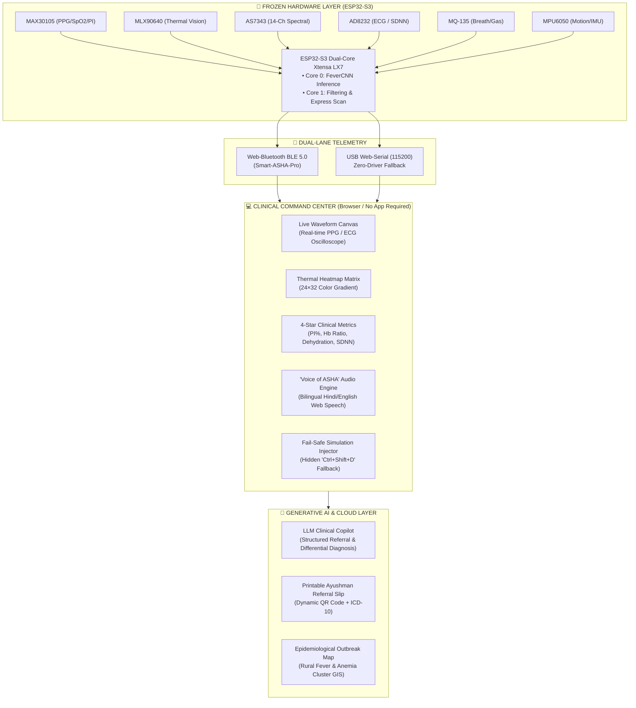

# 📋 Smart-ASHA: Hackathon Software Requirements Specification (SRS) & 30-Hour Tactical Roadmap

**Project Name:** Smart-ASHA (Edge-AI Rural Healthcare Triage Workstation)  
**Hackathon Format:** 30-Hour Sprint  
**Hardware Status:** **FROZEN** (ESP32-S3 + MAX30105, AS7343, MLX90640, AD8232, MQ135, MPU6050, SH1106 OLED, Quectel EC200U 4G/GPS)  
**Software Scope:** Firmware optimization, Web-BLE/Serial Clinical Command Center, Multimodal Generative AI, Bilingual Audio, Fail-Safe Simulation, and Pitch Architecture.

---

## 🎯 1. Executive Objective & Strategy

In a 30-hour hackathon where hardware modifications are frozen, hardware teams often lose because they present raw sensor values on small screens that fail or glitch in front of judges. 

**Smart-ASHA's winning strategy is to turn an embedded sensor prototype into an end-to-end Edge-AI Clinical Workstation & Telemedicine Ecosystem**:
1. **Show, Don’t Squint:** Move the entire visualization from the 0.96" OLED to a high-contrast, fullscreen laptop/tablet **Web Clinical Command Center** running over Web-Bluetooth / Web-Serial.
2. **Speed to Verdict:** Replace the clinical 60-second baseline with a **10-Second Express Triage Mode** tailored for 3-minute judge demos.
3. **The Multimodal AI Hook:** Feed the sensor telemetry into a **Generative AI Health Copilot** that synthesizes clinical impressions, assigns ICD-10 diagnostic codes, speaks real-time bilingual audio advice (Hindi/English), and outputs an **Ayushman Bharat Referral Slip**.
4. **Zero-Flake Demo Guarantee:** Implement an invisible **Fail-Safe Hotkey Simulator** so a disconnected jumper wire never derails the live pitch.

---

## 📐 2. System Architecture & Telemetry Pipeline



---

## 📝 3. Software Requirements Specification (SRS)

### 3.1 Functional Requirements (FR)

| Req ID | Module | Title | Priority | Description |
|:---|:---|:---|:---:|:---|
| **FR-01** | Firmware | **Express Demo Mode (10s Scan)** | `P0 (Critical)` | Add `#define HACKATHON_DEMO_MODE` or command `FAST` in `final_eval_v2.ino` to compress data collection from 60s to 10s with fast rolling convergence for live judging. |
| **FR-02** | Telemetry | **Zero-App Web-BLE & Serial** | `P0 (Critical)` | Provide instant pairing over Chrome Web Bluetooth and USB Web-Serial without installing any native drivers or mobile apps. |
| **FR-03** | Frontend | **Zero-Flake Demo Simulator** | `P0 (Critical)` | Implement hidden keystroke `Ctrl + Shift + D` to toggle between live hardware stream and 3 pre-recorded realistic patient profiles (Normal, Sepsis/Fever, Cold Shock/Arrhythmia). |
| **FR-04** | Audio | **'Voice of ASHA' Bilingual Engine** | `P1 (High)` | Use Web Speech API (`speechSynthesis`) to immediately verbalize diagnostic results in natural Hindi and English upon scan completion. |
| **FR-05** | UI/UX | **Real-Time Canvas Oscilloscope** | `P1 (High)` | Render a dynamic 60 FPS glowing green/cyan medical waveform canvas for PPG and ECG pulses during active scanning. |
| **FR-06** | UI/UX | **Thermal Forehead Heatmap Matrix** | `P1 (High)` | Display a color-mapped 24×32 thermal grid visualizing forehead core temperature vs ambient drift. |
| **FR-07** | GenAI | **LLM Ayushman Referral Generator** | `P1 (High)` | Ingest JSON vitals into an LLM pipeline to produce a formal clinical summary, triage level, and suggested ICD-10 codes. |
| **FR-08** | GenAI | **Printable QR Health Slip** | `P2 (Medium)` | Render a clean, printable/downloadable Ayushman-branded digital triage card with embedded QR code. |
| **FR-09** | Cloud/GIS | **Rural Outbreak Epidemic Map** | `P2 (Medium)` | An interactive district map tab visualizing simulated geotagged Smart-ASHA reports to demonstrate public health surveillance. |

---

### 3.2 Non-Functional Requirements (NFR)

* **NFR-01 (Screen Latency):** Sensor-to-screen render latency must remain $< 300\text{ ms}$ over Web-BLE and $< 100\text{ ms}$ over USB Serial.
* **NFR-02 (Offline Autonomy):** 100% of hardware data capture, Edge ML fever classification, and audio advisory must run completely offline without active internet. The LLM triage generator must have a deterministic offline rule-based fallback if Wi-Fi drops.
* **NFR-03 (Display Legibility):** UI must use high-contrast dark clinical aesthetics (`#0b0f19` background, neon cyan/green accents) with typography readable from 6–8 feet away.
* **NFR-04 (Memory Footprint):** Firmware binary must comfortably fit in the ESP32-S3 `Huge APP (3MB)` partition with zero SRAM stack overflows.

---

## ⏱️ 4. 30-Hour Tactical Hour-by-Hour Roadmap

```
Hour 00 ─── Hour 06 ─── Hour 12 ─── Hour 18 ─── Hour 24 ─── Hour 30
   │           │           │           │           │           │
[Phase 1]   [Phase 2]   [Phase 3]   [Phase 4]   [Phase 5]   [Phase 6]
Firmware    Dashboard   Audio &     GenAI &     Fail-Safe   Pitch &
Express     Waveforms   Thermal     Referral    Rehearsal   Defense
```

### Phase 1: Hours 00:00 – 06:00 | Firmware Lock & Express Scan Mode
* **Goal:** Rock-solid firmware flashed, calibrated, and supporting instant 10s triage.
* **Tasks:**
  1. Open [`Arduino/final_eval_v2/final_eval_v2.ino`](file:///c:/Users/Acer/OneDrive/Desktop/DESKTOP%20VANSH/Smart%20Asha/Arduino/final_eval_v2/final_eval_v2.ino).
  2. Implement `DEMO_SCAN_TIME = 10` seconds toggle via serial command `FAST` or compile switch.
  3. Verify clean boot with zero I²C deadlocks on primary bus (`0x70` TCA9548A) and secondary bus (`Wire1` MAX30105).
  4. Test Web-BLE pairing stability on Chrome laptop.

### Phase 2: Hours 06:00 – 12:00 | Command Center UI & Live Oscilloscope
* **Goal:** Visual WOW factor on laptop screen.
* **Tasks:**
  1. Upgrade [`Arduino/final_eval_v2/web_dashboard.html`](file:///c:/Users/Acer/OneDrive/Desktop/DESKTOP%20VANSH/Smart%20Asha/Arduino/final_eval_v2/web_dashboard.html).
  2. Build a high-performance HTML5 `<canvas>` oscilloscope rendering continuous PPG/ECG pulses.
  3. Build the 24×32 thermal visualizer rendering interpolating color palettes (deep purple to bright yellow).
  4. Display 4-Star metrics cards with radial animated progress gauges.

### Phase 3: Hours 12:00 – 17:00 | "Voice of ASHA" & Fail-Safe Simulator
* **Goal:** Audio immersion + 100% demo invulnerability.
* **Tasks:**
  1. Implement Web Speech API engine in `web_dashboard.html` supporting both Hindi (`hi-IN`) and English (`en-US`) voices.
  2. Implement hidden simulation injector (`Ctrl + Shift + D` or triple-click on brand badge).
  3. Pre-load 3 high-fidelity clinical scenarios:
     * **Profile A (Healthy):** SpO2 99%, HR 72, Temp 36.6°C, Normal PI, Green Triage.
     * **Profile B (Fever & Anemia Risk):** Temp 39.2°C, SpO2 94%, Hb Ratio Alert, Red Triage.
     * **Profile C (Cardiovascular Stress / Shock):** Low PI 0.4%, High SDNN arrhythmia variance, Yellow Triage.

### Phase 4: Hours 17:00 – 22:00 | Generative AI Referral Slip & Telemedicine
* **Goal:** Connect edge sensor outputs to modern GenAI medical workflows.
* **Tasks:**
  1. Implement AI referral generator using Gemini API (with seamless offline rule-based fallback).
  2. Generate structured Ayushman Bharat referral cards with patient metadata, triage tier, and ICD-10 codes.
  3. Add instant printable PDF / image export and dynamic QR code generation.
  4. Build the "Rural Outbreak GIS Map" tab showing simulated district-wide village heatmaps.

### Phase 5: Hours 22:00 – 26:00 | System Integration & Video Backup
* **Goal:** End-to-end dry runs and backup proof creation.
* **Tasks:**
  1. Execute 10 end-to-end test cycles using live hardware + finger placement.
  2. Record a **high-definition 60-second video walkthrough** showing hardware sensor contact and instant dashboard reaction (critical insurance against hackathon Wi-Fi/Bluetooth congestion).
  3. Verify all power supplies, LiPo battery charge, and backup USB-C cables.

### Phase 6: Hours 26:00 – 30:00 | Pitch Deck, Script & Judge Q&A Defense
* **Goal:** Polish the 3-minute pitch and rehearse judge interactions.
* **Tasks:**
  1. Finalize the 10-slide pitch deck emphasizing the **Healthcube Cost Asymmetry** (₹8k vs ₹1.19 Lakh).
  2. Memorize the 3-minute pitch choreography (Timekeeper, Hardware Demoer, Pitcher).
  3. Run aggressive mock Q&A drills on clinical accuracy, drift, and regulatory path.

---

## 👥 5. Team Task Division Matrix

| Team Member | Primary Domain | Hackathon Responsibilities (0–30h) |
|:---|:---|:---|
| **Vansh** *(AI/ML & Edge Deployment)* | **Firmware & Telemetry** | • Express 10s firmware mode in `final_eval_v2.ino`<br/>• BLE JSON payload formatting & Web-Serial fallback<br/>• Fail-Safe simulation data profile generation<br/>• Live hardware demo handling during pitch |
| **Anmol** *(Systems Architect & Pitch)* | **Frontend & GenAI Pipeline** | • `web_dashboard.html` visual overhaul & canvas waves<br/>• LLM Ayushman referral generator & QR export<br/>• Pitch deck creation, value proposition & 3-min script<br/>• Lead pitcher during judging rounds |
| **Gauri** *(Research Lead & Data Science)* | **Clinical Logic & GIS Surveillance** | • Medical validation of triage thresholds & ICD-10 mapping<br/>• "Voice of ASHA" bilingual phrasing & medical prompt tuning<br/>• Rural outbreak GIS surveillance map data<br/>• Q&A defense on medical accuracy and competition |

---

## 🎤 6. The Winning 3-Minute Pitch Script

### [0:00 – 0:45] The Hook & The Problem
> *"Judges, 900 million rural citizens in India rely on 1 million ASHA workers as their sole healthcare defense. But today, an ASHA worker goes into the field empty-handed.  
Existing commercial solutions like Healthcube cost **₹1,20,000 per unit** and require invasive finger-prick blood cartridges that cost rural PHCs over **₹9 Lakhs a year in recurring consumables**. Because of this, 80% of rural health posts leave them in a cupboard."*

### [0:45 – 2:00] The Live Hero Demo
> *"Meet **Smart-ASHA**. It is a portable, 100% non-invasive Edge-AI clinical workstation costing under **₹8,000**—over 10 times cheaper with **zero recurring consumables**.*  
*(Demoer places judge’s or team member’s finger on sensor)*  
*Notice what happens in 10 seconds on our screen:  
1. **MAX30105** calculates Perfusion Index and calibrated SpO₂.  
2. **AS7343** 14-channel spectral sensor runs optical ratiometric hemoglobin and dehydration screening.  
3. **MLX90640** thermal vision detects fever with ambient temperature drift compensation.  
4. **AD8232** extracts autonomic HRV tone.  
*(Dashboard chimes, Voice of ASHA speaks out in Hindi)*  
*And immediately, our Generative AI Health Copilot synthesizes this into an Ayushman Bharat digital referral slip with an emergency QR code for the nearest PHC."*

### [2:00 – 3:00] The Moat, Business Case & Close
> *"Smart-ASHA runs entirely offline on an ESP32-S3 edge processor. When cellular connectivity is available, the onboard Quectel 4G modem syncs geotagged vitals to our district outbreak map, allowing health officials to spot epidemics before they spread.  
Zero consumables. Pocket-sized. Edge-AI powered. Smart-ASHA turns every health worker into a mobile diagnostic clinic. Thank you."*

---

## 🛡️ 7. Judge Q&A Defense Matrix

| Potential Judge Question | Bulletproof Winning Answer |
|:---|:---|
| **"How can you detect anemia without drawing blood?"** | *"We use multi-wavelength ratiometric spectrophotometry via the AS7343 sensor. By comparing the 555nm hemoglobin absorption peak ($F_5$) against the 680nm melanin/tissue baseline ($F_8$), we isolate optical vascular density without interference from skin tone or contact pressure."* |
| **"Is this certified for medical diagnostics?"** | *"Smart-ASHA is engineered as an **Objective Triage and Early-Warning Referral System**, not a final diagnostic replacement for a hospital pathologist. It alerts the ASHA worker whether a patient needs immediate transport to a PHC (Red), monitoring (Yellow), or routine care (Green)."* |
| **"How does the thermal camera handle hot Indian summers?"** | *"Cheap IR sensors drift drastically when ambient temperature exceeds 35°C. In our firmware, we dynamically query the sensor’s substrate die temperature ($T_a$) and apply Stefan-Boltzmann radiation compensation ($V_{IR} \propto T_{obj}^4 - T_{sub}^4$), coupled with our central forehead ROI extraction."* |
| **"Why not just build a smartphone app?"** | *"Smartphones lack medical photoplethysmography with perfusion index, multi-spectral hemoglobin sensors, and radiometric thermal optics. Smart-ASHA provides the specialized medical sensor array, while leveraging Web-BLE so any phone or tablet can act as a zero-install clinical monitor."* |
