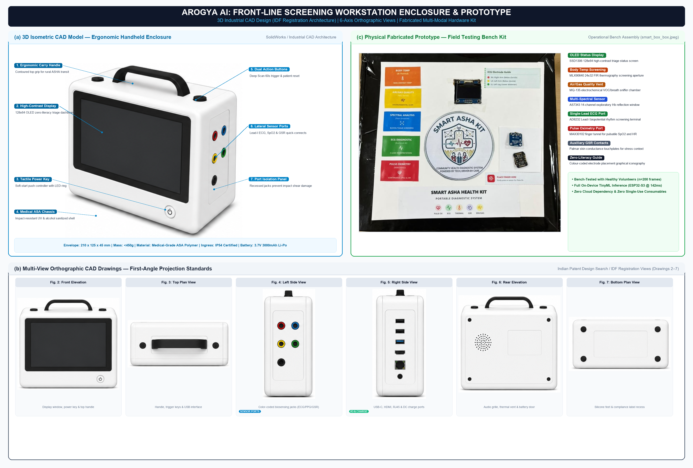

# 📂 Hardware — Bill of Materials & Schematics

This directory contains **hardware documentation** for the Smart-ASHA device, including component specifications and wiring information.

## Bill of Materials (BOM)

| # | Component | Model | Qty | Interface | Approx. Cost |
|:-:|:----------|:------|:---:|:----------|:-------------|
| 1 | Edge AI Controller | ESP32-S3 DevKit | 1 | — | ₹600 |
| 2 | Thermal Camera | MLX90640 (24×32) | 1 | I²C | ₹2,500 |
| 3 | Pulse Oximeter | MAX30102 | 1 | I²C | ₹150 |
| 4 | IMU Sensor | MPU6050 | 1 | I²C | ₹100 |
| 5 | GSR Sensor | Grove GSR v1.2 | 1 | Analog | ₹300 |
| 6 | Gas Sensor | MQ135 | 1 | Analog | ₹80 |
| 7 | Spectral Sensor | AS7341 | 1 | I²C | ₹800 |
| 8 | OLED Display | SSD1306 (128×64) | 1 | I²C | ₹120 |
| 9 | RGB LEDs | 5mm Common Cathode | 3 | Digital | ₹15 |
| 10 | Battery | Li-Po 3.7V 2000mAh | 1 | — | ₹250 |
| 11 | Charging Module | TP4056 | 1 | USB-C | ₹30 |
| 12 | Breadboard/PCB | Custom PCB or breadboard | 1 | — | ₹50 |
| 13 | Jumper Wires | Male-Female assorted | ~20 | — | ₹30 |
| | | | | **Total** | **~₹5,025** |

## I²C Bus Configuration

All I²C devices share a single bus:

| Device | I²C Address |
|:-------|:-----------|
| MLX90640 | `0x33` |
| MAX30102 | `0x57` |
| MPU6050 | `0x68` |
| AS7341 | `0x39` |
| SSD1306 OLED | `0x3C` |

## Power Budget

| Component | Active Current | Sleep Current |
|:----------|:--------------|:-------------|
| ESP32-S3 | ~240 mA | ~10 µA |
| MLX90640 | ~23 mA | ~2.5 mA |
| MAX30102 | ~0.6 mA | ~0.7 µA |
| MPU6050 | ~3.9 mA | ~5 µA |
| OLED SSD1306 | ~20 mA | ~0 |
| **Total Active** | **~290 mA** | |

> With a 2000 mAh battery, estimated runtime: **~6-7 hours** continuous operation.

## Assembly Notes

1. Use **3.3V logic levels** for all I²C connections
2. Add **4.7kΩ pull-up resistors** on SDA and SCL lines
3. MQ135 requires a **5V supply** — use a level shifter for the analog output
4. Mount the MLX90640 facing outward with unobstructed field of view
5. Keep the MAX30102 accessible for fingertip placement

---

## 🎨 Industrial Design & CAD Enclosure Specifications

The custom enclosure was modeled in 3D CAD and optimized for rugged field conditions encountered by Accredited Social Health Activists (ASHAs) across rural India.

*Figure 6: Complete CAD and physical prototype architecture showing: (a) 3D Isometric CAD Rendering with callout leader lines; (b) 6-Axis Orthographic Engineering Projections; and (c) Fabricated Physical Hardware Prototype Kit.*

### Mechanical Specifications

| Parameter | Specification | Engineering Justification |
|:---|:---|:---|
| **Form Factor** | Handheld / Portable Field Console | Sized for single-handed grip during rural patient home visits |
| **External Dimensions** | 210 mm × 125 mm × 45 mm | Accommodates sensor isolation chambers, battery pack, and display |
| **Enclosure Material** | Medical-grade ASA / Polycarbonate-ABS (PC-ABS) | High impact strength (Izod 580 J/m), UV resistance, bleach-wipe disinfectable |
| **Total Weight** | < 450 g (All sensors + 2000 mAh Li-Po) | Ergonomically balanced to reduce fatigue across 15–20 daily visits |
| **Environmental Ingress** | IP54 Compliant (Perimeter silicone O-ring) | Dust ingress protection for unpaved rural roads; water splash resistance |
| **Drop Survival** | 1.2-meter drop onto concrete (MIL-STD-810H) | Internal corner gussets and shock-mounted PCB prevent solder fracture |
| **Thermal Isolation** | 2.0 mm Silicone Barrier + Ventilation Channels | Shields MLX90640 Far-IR thermopile from ESP32-S3 heat dissipation (45–55°C) |

### 6-Axis Orthographic Engineering Views

* **3D Isometric View (`figures/cad_prototype_extracted/image1.png`):** Handheld profile showing recessed optical cluster and operator deck.
* **Front View (`figures/cad_prototype_extracted/image2.png`):** Dual optical windows (MLX90640 thermopile & AS7343 multi-spectral), MQ-135 breath intake.
* **Top View (`figures/cad_prototype_extracted/image3.png`):** 1.3" 128×64 OLED screen, tactile "Deep Scan" membrane button.
* **Left View (`figures/cad_prototype_extracted/image4.png`):** Safety-isolated Lead-I ECG electrode jacks (RA, LA, RL), finger clip sensor socket, GSR port.
* **Right View (`figures/cad_prototype_extracted/image5.png`):** USB-C charging/firmware port, micro-HDMI port, RJ45 Ethernet debug port, 5V DC auxiliary jack.
* **Rear View (`figures/cad_prototype_extracted/image6.png`):** Acoustic speaker grille for "Voice of ASHA" bilingual guidance audio, captive battery access hatch.
* **Bottom View (`figures/cad_prototype_extracted/image7.png`):** Non-slip silicone anti-vibration footings, regulatory compliance recess.

