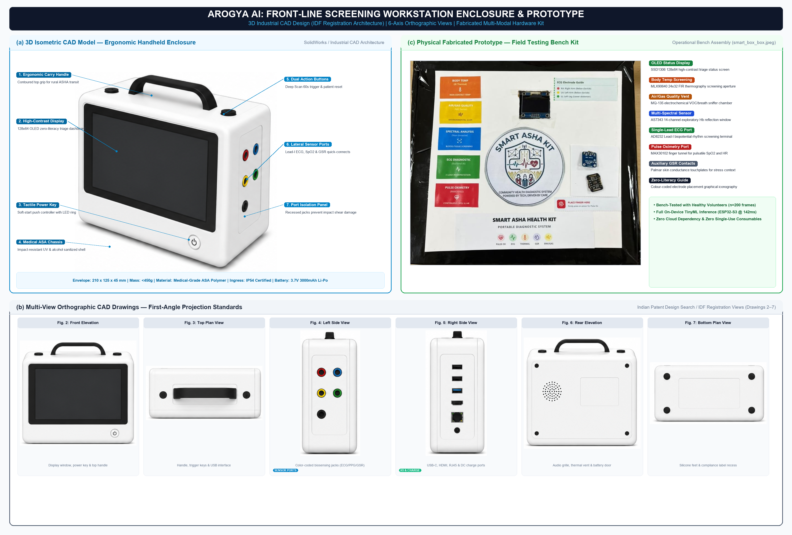
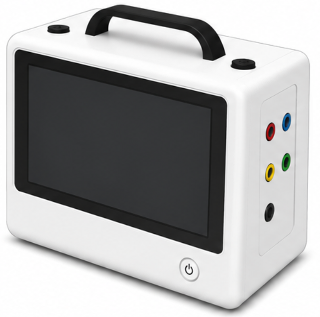
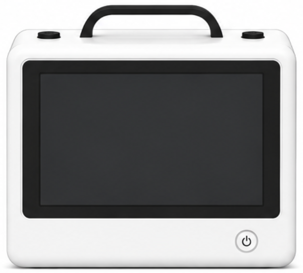
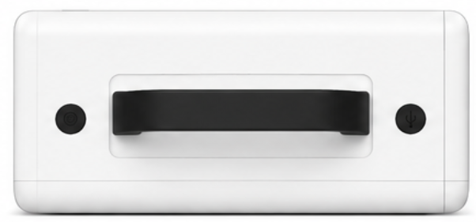
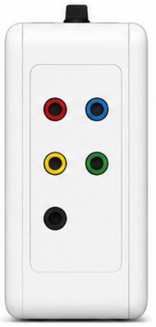
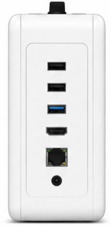
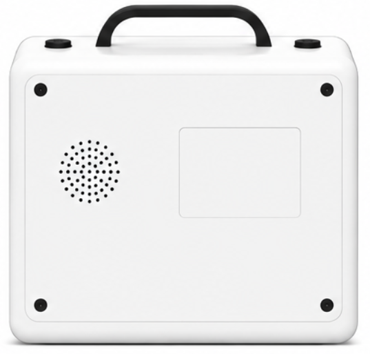
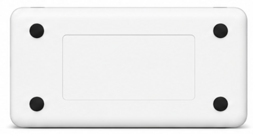

# 🛠️ Smart-ASHA Hardware Assembly & Rebuild Guide

> **Note:** For the comprehensive, bench-level manual with full electrical smoke test procedures, troubleshooting matrices, and Star-Ground noise isolation guidelines, refer to:  
> 📖 [07_hardware_rebuild_and_reassembly_manual.md](file:///c:/Users/Acer/OneDrive/Desktop/DESKTOP%20VANSH/Smart%20Asha/Smart_ASHA_Complete_Dossier/07_hardware_rebuild_and_reassembly_manual.md)  
> Pinout reference: [03_hardware_setup_and_pinout_guide.md](file:///c:/Users/Acer/OneDrive/Desktop/DESKTOP%20VANSH/Smart%20Asha/Smart_ASHA_Complete_Dossier/03_hardware_setup_and_pinout_guide.md)

---

## Quick-Start Rebuild Sequence (Matching `final_eval_v2.ino`)

1. **Power & Ground Foundation:**
   - Establish a **Common Ground (Star Ground)** bus on breadboard/PCB connected to ESP32-S3 `GND`.
   - Distribute regulated `3.3V` from ESP32-S3 to power: TCA9548A, MAX30105, MLX90640, AS7343, MPU6050, SH1106 OLED, and AD8232.
   - Route `5.0V / VBUS` **ONLY** to the `VCC` pin of the MQ-135 Gas sensor heater coil.

2. **Primary I²C Bus (`Wire` @ 50 kHz):**
   - Connect **ESP32-S3 GPIO 8** -> TCA9548A `SDA`
   - Connect **ESP32-S3 GPIO 18** -> TCA9548A `SCL`
   - Connect TCA9548A `RST` -> `3.3V` (Mandatory pull-up)
   - Connect TCA9548A `A0, A1, A2` -> `GND` (Sets I²C address to `0x70`)

3. **Multiplexed Sensor Sub-Buses:**
   - **Port 2:** MPU-6050 6-Axis IMU (`SD2` -> SDA, `SC2` -> SCL, `AD0` -> GND, Address: `0x68`) *(Firmware has Port 1 fallback)*
   - **Port 3:** MLX90640 Thermal Vision (`SD3` -> SDA, `SC3` -> SCL, Address: `0x33`)
   - **Port 4:** AS7343 14-Channel Spectral Suite (`SD4` -> SDA, `SC4` -> SCL, Address: `0x39`)
   - **Port 7:** SH1106 128×64 OLED Display (`SD7` -> SDA, `SC7` -> SCL, Address: `0x3C`)
   - *(Ports 0, 1, 5, 6 remain unconnected)*

4. **Secondary Isolated I²C Bus (`Wire1` @ 400 kHz):**
   - Connect **ESP32-S3 GPIO 16** -> MAX30105 `SDA`
   - Connect **ESP32-S3 GPIO 17** -> MAX30105 `SCL`
   - Connect MAX30105 `VIN` -> `3.3V`, `GND` -> `GND`
   - *(Completely bypasses TCA9548A to prevent high-speed optical FIFO bottlenecks)*

5. **Calibrated Analog Channels (ESP32-S3 ADC1):**
   - Connect AD8232 ECG `OUTPUT` -> **ESP32-S3 GPIO 4** (`ADC1_CH3`)
   - Connect MQ-135 Gas `AOUT` -> **ESP32-S3 GPIO 6** (`ADC1_CH5`)
   - *(GSR and discrete LEDs are omitted in `final_eval_v2.ino`)*

6. **Cellular & GNSS Connections:**
   - Insert 4G LTE SIM Card into the 7Semi onboard Micro-SIM slot.
   - Connect LTE antenna to `MAIN` u.FL connector.
   - Connect active GNSS patch antenna to `GNSS` u.FL connector.

7. **Pre-Power Verification:**
   - Use multimeter continuity tester to confirm NO shorts between 3.3V and GND, or between 5V and 3.3V.
   - Power on via USB-C and open Serial Monitor at **115200 baud**.
   - Verify all 4 sensor suites report `[OK]`.

---

## 📐 Industrial Design, CAD Enclosure & Prototype Architecture

The Smart-ASHA (Arogya AI) device features a custom, ergonomic medical enclosure engineered specifically for Indian frontline community health workers (ASHAs). The mechanical enclosure was designed using parametric CAD (Autodesk Fusion 360 / SolidWorks) and manufactured via additive manufacturing (Medical-Grade ASA/PC-ABS blend, 100% infill shell, IP54 sealing).

### Composite Hardware Architecture (CAD & Fabricated Prototype)

*Figure 6: Comprehensive Hardware Prototype Architecture combining: (a) 3D Isometric CAD Rendering with functional callout leader lines; (b) 6-Axis Orthographic Engineering Projections detailing sensor apertures and external interfaces; and (c) Fabricated Physical Hardware Prototype Kit with sensor layout and transit case.*

---

### 🔍 Orthographic Engineering Projections (Extracted from Invention Disclosure Document)

| Projection View | CAD Reference | Functional Mechanical Features |
|:---|:---:|:---|
| **3D Isometric Perspective** |  | Ergonomic contours for female hand span (5th–95th percentile Indian anthropometry), recessed optical bay, operator interface deck. |
| **Front Elevation** |  | Dual optical apertures (MLX90640 Far-IR thermography & AS7343 14-channel spectral sensor), MQ-135 breath intake grille, diffused 3-State LED. |
| **Top Plan View** |  | 1.3" 128×64 OLED graphical screen window, tactile "Deep Scan" membrane push-button, high-contrast status badge. |
| **Left Lateral Profile** |  | Safety-isolated Lead-I ECG electrode jacks (RA, LA, RL 3.5mm TRRS), MAX30105 finger clip port, Grove GSR bipolar terminal. |
| **Right Lateral Profile** |  | High-speed USB-C charging/firmware port, micro-HDMI external monitor port, RJ45 industrial Ethernet debug jack, 5V auxiliary DC power. |
| **Rear Elevation** |  | Acoustic speaker grille for "Voice of ASHA" bilingual audio engine (Hindi/English), captive thumbscrew battery compartment door. |
| **Bottom Plan View** |  | Anti-slip silicone vibration-damping footings, recessed regulatory compliance decal, tripod/mounting socket. |

---

### 🧰 Mechanical Enclosure Assembly Sequence

1. **Brass Insert Installation:**
   - Press-fit four M2.5 threaded brass heat-set inserts into internal mounting bosses using a temperature-controlled soldering iron at 220°C.
2. **Thermal Baffle & Radiative Isolation:**
   - Install a 2.0 mm medical-grade silicone thermal isolation gasket between the ESP32-S3 MCU processing zone and the MLX90640 thermal sensor compartment.
   - This prevents MCU conductive heat dissipation (45°C–55°C during active inference) from inducing thermal measurement drift on the infrared thermopile array.
3. **Optical Shroud & Light Occlusion:**
   - Seat the shore 40A black silicone shroud around the AS7343 multi-spectral sensor and MAX30105 optical aperture.
   - Ensures zero ambient stray light (50 Hz/100 Hz fluorescent/LED flicker) compromises reflectance readings during finger and skin contact scans.
4. **Main Electronics Deck Mounting:**
   - Secure the main controller PCB onto lower enclosure bosses using M2.5 × 6mm stainless-steel machine screws with nylon washers.
   - Route Lead-I biopotential wiring along the left channel to minimize proximity to high-frequency 4G LTE antenna leads.
5. **Operator Console Deck Integration:**
   - Affix the SH1106 OLED display and diffused 8mm tri-color LED to the upper shell bezel.
   - Seat the tactile push-button with silicone weather-seal gasket.
6. **Perimeter Sealing & Final Closure:**
   - Lay continuous 1.5mm silicone O-ring cord into the perimeter mating tongue-and-groove channel.
   - Fasten top and bottom enclosure halves with four M2.5 × 16mm perimeter security screws.
   - Install 3.7V 2000 mAh Li-Po battery pack into rear captive compartment and secure door with captive knurled screw.
